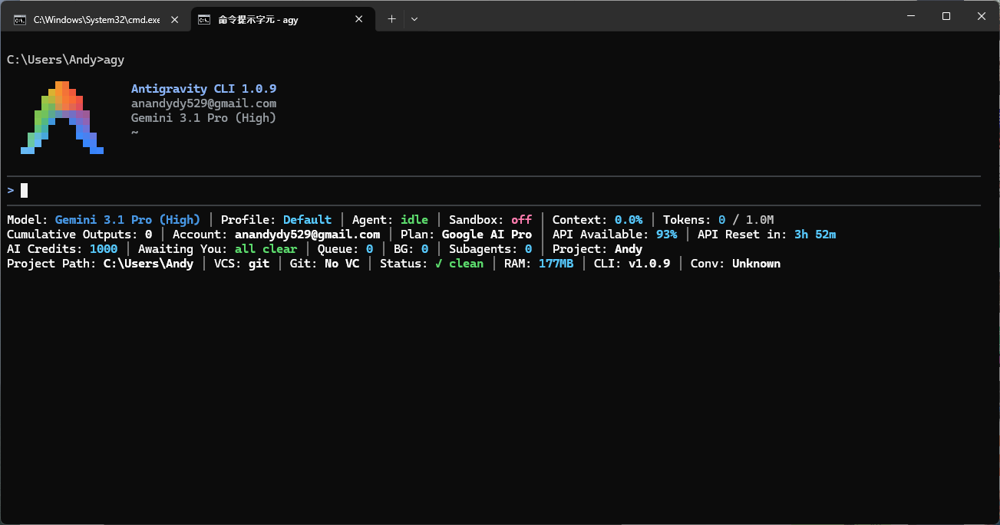
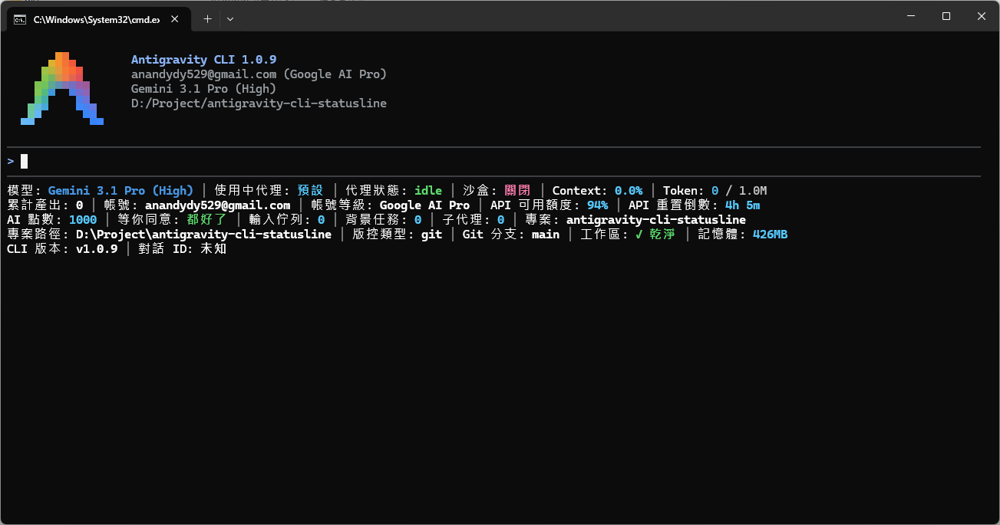
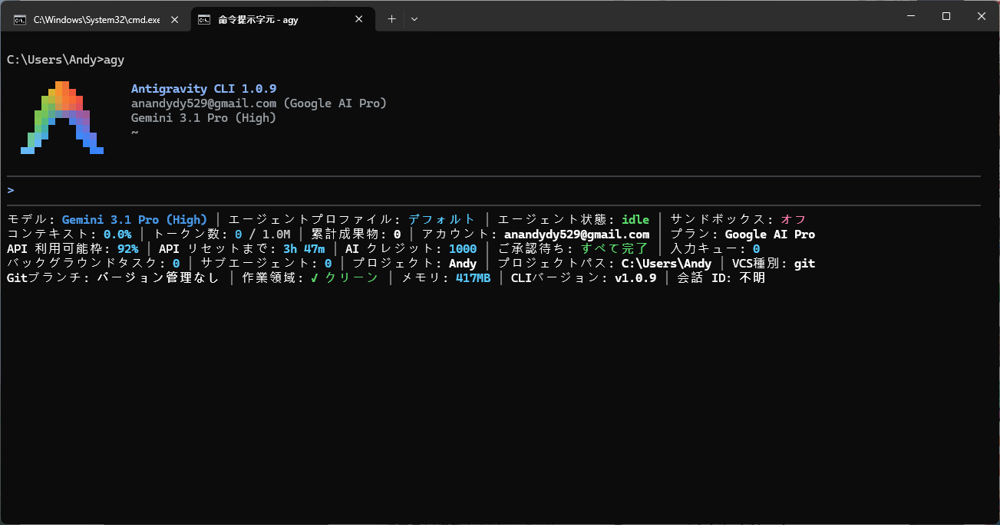
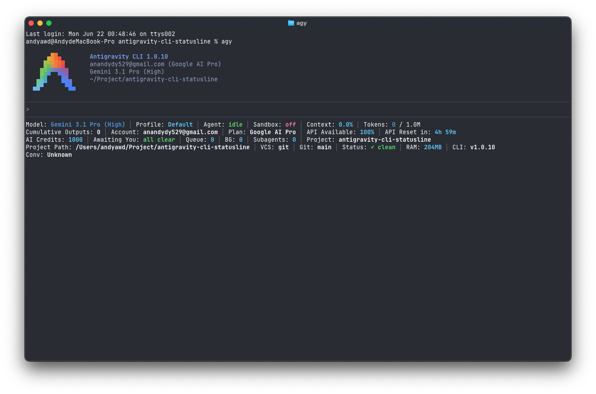
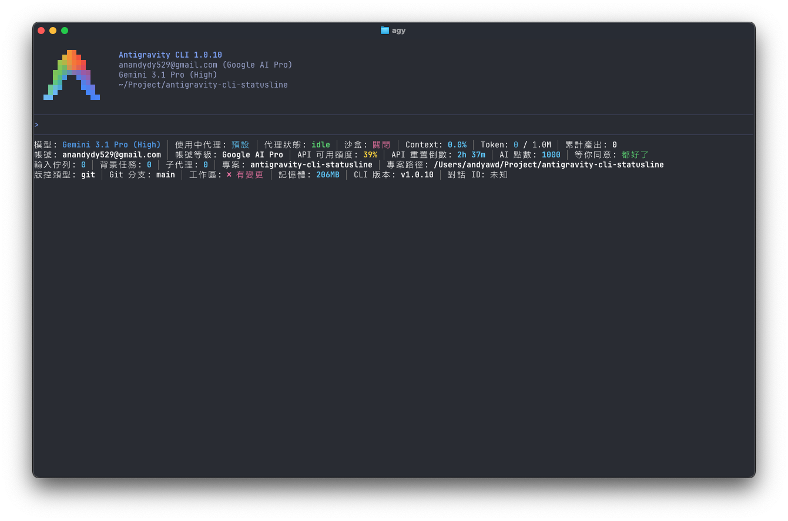
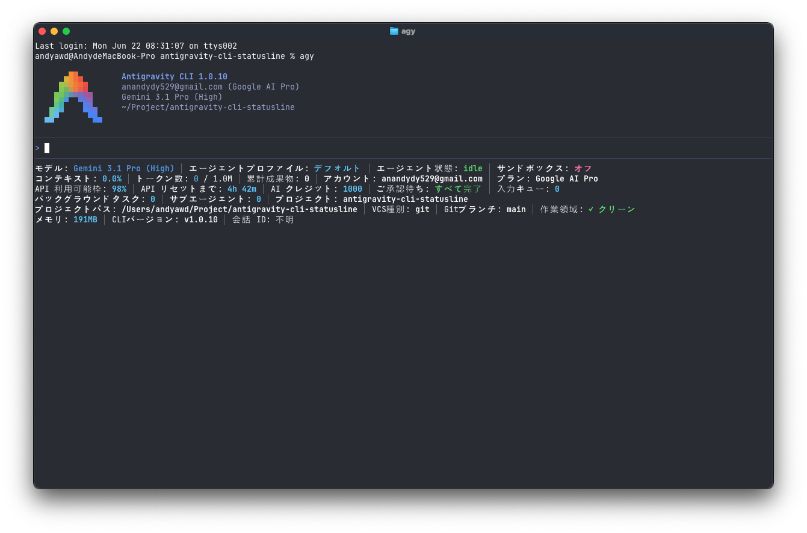

# antigravity-cli-statusline

[English](README.md) | [繁體中文](README.zh-TW.md) | [简体中文](README.zh-CN.md) | 日本語

[](skills/agy-cli-statusline/SKILL.md)
[](LICENSE)
[]()

Google Antigravity（AGY）向けのプラグインです。Antigravity コマンドラインインターフェース（CLI）（`agy`）のステータスライン（Statusline / Footer）をカスタマイズし、36種類のリアルタイム指標から自由に選択、テキスト（`text`）または絵文字（Emoji）（`emoji`）ラベル表示スタイルの切り替え、表示順序のカスタマイズ、パーセント容量バーグラフの結合または個別表示モードの切り替え、自動および手動改行メカニズムを備え、4つの言語（`us`、`zh-tw`、`zh-cn`、`jp`）に対応しています。

Google Antigravity の3大コアプラットフォームを包括的にサポート：Antigravity コマンドラインインターフェース（`agy`）、Antigravity 統合開発環境（IDE）、および Antigravity 2.0 デスクトップアプリケーション。

## ステータスライン設定とリアルタイムテレメトリの動作デモ

<p align="center">
  
</p>

これは Antigravity コマンドラインインターフェース（CLI）ステータスラインの対話型設定から実際のリアルタイム動作までの動的デモです。設定コマンド `/antigravity-cli-statusline:agy-cli-statusline` の実行、各フェーズの `ask_question` アンケート対話、カスタムレイアウト入力、そして最終的に表示される 11 行の高情報密度ステータスラインを完全に収録しています：

1. **設定コマンドの実行と言語選択**：`/antigravity-cli-statusline:agy-cli-statusline` を実行して対話型設定ウィザードを起動し、最初のステップで表示言語（日本語、繁体字中国語、簡体字中国語、英語）を即座に選択して固定します。
2. **5大カテゴリ指標のページネーション選択**：`ask_question` カテゴリ別ページネーションウィザード（1/5 〜 5/5）を通じて全 36 項目の指標を網羅し、ターミナルの行数制限やスクロールによる切り捨て問題を解決します。
3. **手動並び替えと個別スタイル Write-in**：1行の入力欄でカスタム順序とプレフィックスの入力に対応（例: `e:model-name` で絵文字、`quota` でテキストモード、`n` で強制改行、`n,n` で空白の区切り行を作成）。
4. **設定同期と即時ホットリロード**：CLI 固有設定、グローバル設定、プロジェクト設定の3層の `settings.json` および `trusted_hooks.json` 信頼メカニズムを自動同期し、CLI を再起動することなく即座にホットリロードが適用され、11 行のカスタムステータスラインが展開されます。
5. **11 行のステータスラインによるリアルタイムテレメトリ**：カスタム順序に従い、AI モデル、利用可能クォータと 10 マスのプログレスバー、コンテキストとトークン数、アクティブなサブエージェント、Git バージョン管理、システムメモリをリアルタイムに追跡します。

### 実際の画面スクリーンショット

#### Windows

| 英語 (us) | 繁体字中国語 (zh-tw) | 簡体字中国語 (zh-cn) | 日本語 (jp) |
| :---: | :---: | :---: | :---: |
|  |  | *(zh-cn モード対応)* |  |

#### macOS

| 英語 (us) | 繁体字中国語 (zh-tw) | 簡体字中国語 (zh-cn) | 日本語 (jp) |
| :---: | :---: | :---: | :---: |
|  |  | *(zh-cn モード対応)* |  |

## インストール方法

Antigravity コマンドラインインターフェース（CLI）を使用してグローバルにインストールします：

```bash
agy plugin install https://github.com/AndyAWD/antigravity-cli-statusline
```

### 前提条件

- **Node.js**（必須）：レンダラースクリプトは純粋な `.mjs` で記述されています。Node.js がない場合、ステータスラインは完全に空白のままとなり、30回連続で失敗した後に `agy` によって自動的に無効化されます。本スキルは設定を書き込む前に Node.js の利用可否を事前確認します。
- **Git**（任意）：`git-branch`、`vcs-dirty`、および `vcs-type` 指標を表示するために必要です。

### 有効化の挙動

- **初回有効化**：ステータスラインを初めてインストールまたは有効化する場合、`agy` CLI は実行時に新しいフックプロセスを動的に登録しません。`agy` CLI を再起動（一度終了して再度開く）してステータスラインフックを読み込んでください。
- **ホットリロード**：一度有効化された後は、指標の並び順、ラベルスタイル（`text` / `emoji`）、または表示言語を変更しても、CLI を再起動することなく即座に反映されます。

## 主な機能

1. **マルチプラットフォーム対応**：Windows、macOS、Linux 上の Antigravity CLI ターミナル、Antigravity IDE サイドバーチャット、および Antigravity 2.0 デスクトップアプリケーションをサポート。
2. **36種類のリアルタイム指標、4つのロケール＆デュアルラベルスタイル**：AI モデル状態、API クォータ（5時間、週間、Gemini 4 Argon 専用クォータプールを含む）、コンテキスト／トークン消費量、対話キュー、Git/VCS 状態、システムテレメトリなど 36 指標を英語（`us`）、繁体字中国語（`zh-tw`）、簡体字中国語（`zh-cn`）、日本語（`jp`）で提供し、**テキスト（`text`）**または**絵文字（`emoji`、コロンなしコンパクト）**ラベル表示スタイル（`ui.footer.labelStyle`）を選択可能。
3. **柔軟なバーグラフ表示（結合または個別）**：5時間クォータ、週間クォータ、Gemini 4 Argon クォータ、コンテキスト使用量、セッショントークンに対して 10 マスの視覚的プログレスバー（`[████████░░]`）を描画。数値指標と隣接して配置された場合は自動的にラベルを結合し、離れて配置された場合は個別のラベルで表示。
4. **カスタム並び替え＆デュアル改行メカニズム**：1始まりのインデックス並び替え、`n` による手動改行、`n,n` による空白行のセクション区切り、およびターミナル幅を考慮した自動折り返しに対応。
5. **24ビット4段階カラーコーディング**：4つのしきい値（`100–75%` 青、`74–50%` 緑、`49–25%` 黄、`24–0%` 赤）で色が動的に変化し、各 AI モデルファミリー（Gemini、Claude、GPT）専用のブランドアクセントカラーも表示。
6. **3層設定同期＆OS セーフガード**：CLI 固有設定、グローバル設定、ワークスペース設定の3層の `settings.json` と `trusted_hooks.json` を同期し、macOS/Linux の NVM パス解決や Windows の UTF-8 Byte Order Mark（BOM）防止を安全に処理。

## プラグイン管理

• インストール済みプラグインの一覧表示：

  ```bash
  agy plugin list
  ```

• プラグインの有効化：

  ```bash
  agy plugin enable antigravity-cli-statusline
  ```

• プラグインの無効化：

  ```bash
  agy plugin disable antigravity-cli-statusline
  ```

• プラグインのアンインストール：

  ```bash
  agy plugin uninstall antigravity-cli-statusline
  ```

## ディレクトリ構造

```text
antigravity-cli-statusline/
├── plugin.json
├── package.json
├── LICENSE
├── CONTRIBUTING.md
├── README.md
├── README.zh-TW.md
├── README.zh-CN.md
├── README.ja.md
├── docs/
│   └── images/
└── skills/
    └── agy-cli-statusline/
        ├── SKILL.md
        ├── references/
        │   ├── config-files.md
        │   ├── pitfalls.md
        │   └── windows.md
        ├── resources/
        │   └── questions.json
        └── scripts/
            ├── configure-statusline.mjs
            ├── diagnose-statusline.mjs
            ├── fetch-local-quota.mjs
            ├── sh_hidden.cs
            ├── statusline-quota.mjs
            └── test-counters.mjs
```

## コマンドとスキル

インストール後、スラッシュコマンドを使用して設定ワークフローを起動します：

### 1. ステータスラインの設定

```text
/antigravity-cli-statusline:agy-cli-statusline
```

- **使用するタイミング**：初めてステータスラインを有効化するとき、表示言語（`us` / `zh-tw` / `zh-cn` / `jp`）を切り替えるとき、テキスト（`text`）と絵文字（`emoji`）のラベルスタイルを切り替えるとき、指標を選択するとき、または複数行のレイアウト順序をカスタマイズするとき。
- **動作の仕組み**：
  1. 表示言語の選択を求め、セッション出力をそのロケールに固定します。
  2. Node.js 環境の利用可否を検証し、3層の `settings.json` ファイルを確認します。
  3. `questions.json` から 5 つのカテゴリ別タブにわたって指標の選択を順次プロンプトし、ターミナル画面の高さ制限による切り捨て（Issue #1262）を防ぎます。
  4. 選択された指標を表示し、個別スタイルプレフィックス付きのカスタム並び順を受け付け（純粋な数字、`t` テキストプレフィックス、`e` 絵文字プレフィックス、`n` 改行トークンに対応）、3層すべての `settings.json` に `ui.footer.items` と `ui.footer.itemStyles` を書き込み、フックスクリプトを `~/.gemini/antigravity-cli/hooks/` に配置します。
  5. 完了時に、将来の調整で簡単にコピー＆ペーストできるよう、前回および今回のレイアウト順序文字列を含むコードブロックを自動的に出力します。

---

## 指標、並び替え＆改行

### 利用可能な指標（1–36）

以下の番号は、ステップ 3（`resources/questions.json`）の 5 カテゴリにわたる 1 始まりの選択肢インデックス、および `emoji` モードで使用される絵文字プレフィックスに対応しています：

**1. モデルと代理（4項目）**
- `1.` 🤖 **AIモデル名（`model-name`）** — 現在の会話を担当している人工知能モデル
- `2.` 🪪 **エージェントプロファイル（`agent-profile`）** — 読み込まれているエージェントプロファイル名
- `3.` ⚡ **エージェント状態（`agent-state`）** — `idle / thinking / working / tool_use / initializing`
- `4.` ⚙️ **実行モード（`mode`）** — `default / code-only / plan / interactive / accept-edits`

**2. クォータ、課金とアカウント（14項目）**
- `5.` 🔋 **5時間利用可能クォータ（`quota`）** — 5時間 API 残量パーセンテージ、4段階カラー表示
- `6.` 🔋 **5時間利用可能クォータバーグラフ（`quota-bar`）** — 10マスの5時間クォータバー（`[████████░░]`）
- `7.` ⏳ **5時間クォータリセットカウントダウン（`quota-reset-countdown`）** — 5時間クォータ更新までの残り時間
- `8.` 🕒 **5時間リセット時刻（`quota-reset-time`）** — ローカルタイムゾーンでのリセット時刻（同日なら `HH:mm`、日を跨ぐ場合は `yyyy/MM/dd HH:mm`）
- `9.` 📅 **週間利用可能クォータ（`quota-weekly`）** — 週間 API 残量パーセンテージ、4段階カラー表示
- `10.` 📅 **週間利用可能クォータバーグラフ（`quota-weekly-bar`）** — 10マスの週間クォータバー（`[███████░░░]`）
- `11.` ⏲️ **週間クォータリセットカウントダウン（`quota-weekly-countdown`）** — 週間クォータ更新までの残り時間
- `12.` 🗓️ **週間リセット時刻（`quota-weekly-reset-time`）** — 週間ローカルリセット時刻（例: `2026/10/18 16:00`）
- `13.` ✨ **Gemini 4 Argon 利用可能クォータ（`quota-argon`）** — Gemini 4 Argon 専用クォータパーセンテージ、4段階カラー表示
- `14.` ✨ **Gemini 4 Argon クォータバーグラフ（`quota-argon-bar`）** — 10マスの Argon クォータバー（`[█████░░░░░]`）
- `15.` ⏱️ **Gemini 4 Argon リセットカウントダウン（`quota-argon-countdown`）** — Argon クォータ更新までの残り時間
- `16.` ⏰ **Gemini 4 Argon リセット時刻（`quota-argon-reset-time`）** — Argon ローカルリセット時刻（例: `2026/10/30 23:57`）
- `17.` 💎 **加入プラン（`plan-tier`）** — 現在のサブスクリプションプランレベル
- `18.` 📧 **アカウントメール（`account-email`）** — ログイン中のアカウントメールアドレス

**3. コンテキストとトークン（4項目）**
- `19.` 🧠 **コンテキスト使用量（`context-used`）** — 消費されたコンテキストウィンドウの割合
- `20.` 🧠 **コンテキスト使用量バーグラフ（`context-used-bar`）** — 10マスのコンテキスト消費バー（`[█░░░░░░░░░]`）
- `21.` 💰 **トークン数（`token-count`）** — 現在のセッションで消費された正確なトークン数
- `22.` 💰 **トークン数バーグラフ（`token-count-bar`）** — 10マスのトークン消費バー（`[█░░░░░░░░░]`）

**4. ワークスペースと VCS（5項目）**
- `23.` 📁 **ワークスペース名（`project-path`）** — 現在のワークスペースディレクトリ名
- `24.` 📍 **ワークスペース絶対パス（`project-full-path`）** — ワークスペースの絶対ディレクトリパス
- `25.` 🔀 **Git ブランチ（`git-branch`）** — 現在のアクティブなブランチ名
- `26.` 🔍 **VCS 変更状態（`vcs-dirty`）** — `未コミット / 変更なし`
- `27.` 🗃️ **VCS 種別（`vcs-type`）** — `git / jj / fig`

**5. システム状態とバックグラウンドタスク（9項目）**
- `28.` 💾 **CLI メモリ使用量（`memory-usage`）** — `agy` プロセスが消費している RSS メモリ
- `29.` 🚀 **Antigravity CLI バージョン（`cli-version`）** — 現在の CLI バージョン文字列
- `30.` 💬 **会話番号（`conversation-id`）** — デバッグ用の会話識別子の先頭8文字
- `31.` 🛡️ **サンドボックス状態（`sandbox-status`）** — `オフ / オン（ネット） / オン（オフライン）`
- `32.` 🔔 **ツール承認待ち（`tool-confirmation`）** — ツール確認ダイアログの応答待ち状態
- `33.` 📥 **保留中の入力（`pending-input`）** — 実行待ちのユーザー入力キュー
- `34.` 🔄 **実行中バックグラウンドタスク（`background-tasks`）** — 稼働中のバックグラウンドタスク数
- `35.` 👥 **アクティブなサブエージェント（`subagents`）** — 稼働中のサブエージェント数
- `36.` 📄 **成果物数（`artifacts`）** — このセッションで生成された累積ファイル・成果物数

### ラベル表示スタイル：テキスト（`text`）vs. 絵文字（`emoji`）

各指標のスタイルは、ステップ 4 の並び替え時にスタイルプレフィックスを指定してカスタマイズできます（`settings.json` の `ui.footer.itemStyles` マップに保存され、未設定の項目は厳密にテキストがデフォルトとなります）：

- **テキストラベルスタイル（`text`、デフォルト）**：ローカライズされたテキストプレフィックスとコロンを表示（例: `モデル: Gemini 3.1 Pro │ 五時間残量: 88% │ ブランチ: main`）。プレーンな数字（例: `1`）、`t` プレフィックス（例: `t1`）、またはプレーンな英字識別子（`quota`、`t:quota`）はすべてテキストスタイルとして処理されます。
- **絵文字ラベルスタイル（`emoji`）**：テキストラベルのプレフィックスとコロンを指標の絵文字とスペース1文字に置き換え（例: `🤖 Gemini 3.1 Pro │ 🔋 88% │ 🔀 main`）、状態値（`なし`、`変更なし`、`オフ`）は選択した言語でローカライズされたまま維持されます。`e` プレフィックス（例: `e1`、`e:quota`）を使用して絵文字スタイルを指定します。自由に混在させることが可能です（例: `1, e2, t3, e:git-branch`）。
- **バーグラフのスタイル競合処理**：隣接するバーグラフ指標のスタイルが競合している場合（一方がテキスト、もう一方が絵文字）、それらは結合されず、2つの独立したブロックとして描画されます。

### パーセントバーグラフ：結合表示 vs. 個別表示

デフォルトのバーの長さは 10 マス（`[████████░░]`）で、`settings.json` の `ui.footer.barLength` で設定可能です。塗りつぶしブロック `█` は容量または使用量を表し、影付きブロック `░` は空き領域を表します。リセット時刻の表示形式は `ui.footer.timeFormat`（`"smart"`、`"yyyy/MM/dd HH:mm"`、`"12h"`、または `"24h"`）で設定可能です。

5組の指標がパーセントバーグラフに対応しています：
- `quota`（`5`）+ `quota-bar`（`6`）
- `quota-weekly`（`9`）+ `quota-weekly-bar`（`10`）
- `quota-argon`（`13`）+ `quota-argon-bar`（`14`）
- `context-used`（`19`）+ `context-used-bar`（`20`）
- `token-count`（`21`）+ `token-count-bar`（`22`）

#### 1. 結合表示の例（隣接時の自動結合）

数値指標とそれに対応するバーグラフが**隣接**して配置されている場合（順序は問いません。例: `5,6` または `6,5`）、レンダラーはそれらを自動的に1つのラベルと区切り記号の下に結合します：

- **並び替え入力**：
  ```text
  19,20,21,22,n,5,6,9,10,n,13,14
  ```
- **結合出力プレビュー（テキストモード `text`）**：
  ```text
  コンテキスト使用: 18.5% [█░░░░░░░░░] │ トークン: 185.0k / 1.0M [█░░░░░░░░░]
  五時間残量: 88% [████████░░] │ 七日間残量: 78% [███████░░░]
  Argon 残量: 59% [█████░░░░░]
  ```
- **結合出力プレビュー（絵文字モード `emoji`）**：
  ```text
  🧠 18.5% [█░░░░░░░░░] │ 💰 185.0k / 1.0M [█░░░░░░░░░]
  🔋 88% [████████░░] │ 📅 78% [███████░░░]
  ✨ 59% [█████░░░░░]
  ```

#### 2. 個別表示の例（非隣接 / 独立したラベル）

数値指標とそれに対応するバーグラフが他の指標や改行 `n` で**隔てられている**場合（またはバー指標のみが選択されている場合）、各指標は独自のラベルとともに個別に描画されます：

- **並び替え入力**：
  ```text
  19,21,n,20,22,n,5,7,6,n,9,11,10,n,13,15,14
  ```
- **個別出力プレビュー**：
  ```text
  コンテキスト使用: 18.5% │ トークン: 185.0k / 1.0M
  コンテキスト使用: [█░░░░░░░░░] │ トークン: [█░░░░░░░░░]
  五時間残量: 88% │ 五時間リセット: 4h 50m │ 五時間残量: [████████░░]
  七日間残量: 78% │ 七日間リセット: 4d 5h │ 七日間残量: [███████░░░]
  Argon 残量: 59% │ Argon リセット: 6d 1h │ Argon 残量: [█████░░░░░]
  ```

### 並び替えと個別スタイルプレフィックス

スキルワークフローのステップ 4 において、Write-in 入力欄にカンマ区切りの数値を入力することでレイアウトと個別スタイルをカスタマイズできます：

- **数字インデックスバージョン**：
  ```text
  e1,e18,e17,e31,n,e2,3,35,36,33,34,32,n,n,19,20,21,22,n,5,6,7,8,n,9,10,11,12,n,13,14,15,16,n,n,26,27,e25,n,e23,24,n,e4,e30,e28,29
  ```

- **英字識別子バージョン**：
  ```text
  e:model-name,e:account-email,e:plan-tier,e:sandbox-status,n,e:agent-profile,agent-state,subagents,artifacts,pending-input,background-tasks,tool-confirmation,n,n,context-used,context-used-bar,token-count,token-count-bar,n,quota,quota-bar,quota-reset-countdown,quota-reset-time,n,quota-weekly,quota-weekly-bar,quota-weekly-countdown,quota-weekly-reset-time,n,quota-argon,quota-argon-bar,quota-argon-countdown,quota-argon-reset-time,n,n,vcs-dirty,vcs-type,e:git-branch,n,e:project-path,project-full-path,n,e:mode,e:conversation-id,e:memory-usage,cli-version
  ```

- **数字**：ステップ 3 の選択における 1 始まりの位置を表します（全 36 指標を選択した場合、数字 `1`〜`36` は上記リストに対応します）。
- **スタイルプレフィックス**：
  - プレーンな数字（例: `1`）または `t1`、プレーンな英字識別子（`quota`、`t:quota`）は**テキストラベル**としてフォーマットされます。
  - `e1` または `e:quota` は**絵文字アイコン**としてフォーマットされます（大文字・小文字を区別しません）。
  - 自由に混在させることができ（例: `e1, 18, e17, 31`）、スタイルが指定されていない項目はデフォルトでテキストラベルになります。
- **英字識別子**：`quota` や `model-name` などの識別子も直接使用したり、数字と混在させることができます。
- **`n` トークン**：強制的に改行を挿入します。連続した `n,n` を入力すると空白行が挿入され、論理グループを区切ることができます。
- **指定されなかった指標は非表示になります** — 並び替え文字列が最終的な表示セットを定義します。
- 空白のままにするか `スキップ` を選択すると、元の選択順序を維持し、選択されたすべての指標が有効化されます（デフォルトのテキストスタイル）。
- **設定履歴の保持**：スキルの完了時に、以前および新しく設定された並び替え文字列が自動的に表示され、将来の調整のために即座にコピー＆ペーストできます。

並び替え後のステータスライン表示プレビュー — **混在／個別スタイルモード**（4つの論理グループ、空行で区切られた計8行の情報）：

```text
🤖 Gemini 3.8 Flash (High) │ 📧 anandydy529@gmail.com │ 💎 Google AI Pro │ 🛡️ オフ
🪪 Default │ 状態: 実行中 │ サブ代理: 2 │ 成果物: 0 │ 入力キュー: 0 │ BGタスク: 0 │ ご承認待ち: なし

コンテキスト使用: 18.5% [█░░░░░░░░░] │ トークン: 185.0k / 1.0M [█░░░░░░░░░]
五時間残量: 88% [████████░░] │ 五時間リセット: 4h 50m │ 五時間リセット時刻: 15:50
七日間残量: 78% [███████░░░] │ 七日間リセット: 4d 5h │ 七日間リセット時刻: 2026/10/18 16:00
Argon 残量: 59% [█████░░░░░] │ Argon リセット: 6d 1h │ Argon リセット時刻: 2026/10/30 23:57

版管理状態: 変更なし │ 版管理種別: git │ 🔀 main
📁 antigravity-cli-statusline │ パス: /Users/andyawd/Project/antigravity-cli-statusline
⚙️ Accept-edits │ 💬 c5168b1c │ 💾 279MB │ バージョン: v1.3.2
```

### 改行動作

2つのメカニズムが連携して動作します：

1. **スマート自動改行**：レンダラーがターミナル幅を読み取り、現在の行から溢れる場合は次の指標を自動的に新しい行に折り返します。
2. **手動改行（`n`）**：並び替え文字列に `n` を挿入することで、その正確な位置で強制的に改行します：

```text
1,2,n,3,4
```

### 動的カラー表示

24ビットトゥルーカラーの4段階パレット（`#57caff` 青 → `#5cdb6d` 緑 → `#ffd427` 黄 → `#ff7daf` 赤）が、残りの API クォータとコンテキストウィンドウの消費圧迫度に応じて動的に変化します。また、各 AI モデルファミリー（Gemini、Claude、GPT）も専用のブランドアクセントカラーで描画されます。

## コントリビューション

新しい指標の追加、クロスプラットフォームの修正、言語翻訳など、あらゆる貢献を歓迎します。詳細なワークフローについては [CONTRIBUTING.md](CONTRIBUTING.md) を参照してください。

## 謝辞

クォータ監視機能のインスピレーションを与えてくださった [60ke/antigravity-statusline](https://github.com/60ke/antigravity-statusline) に特別な感謝を捧げます。彼らのオリジナルプロジェクトがステータスライン統合の道を切り拓きました。元の実装は Python で記述されており、Windows と macOS の間で一貫して実行することが難しい場合があったため、本プロジェクトは外部の Python 依存関係に頼ることなくシームレスなクロスプラットフォーム互換性を確保するため JavaScript（Node.js）で書き直されました。

## ライセンス

[MIT License](LICENSE) © 2026 AndyAWD
