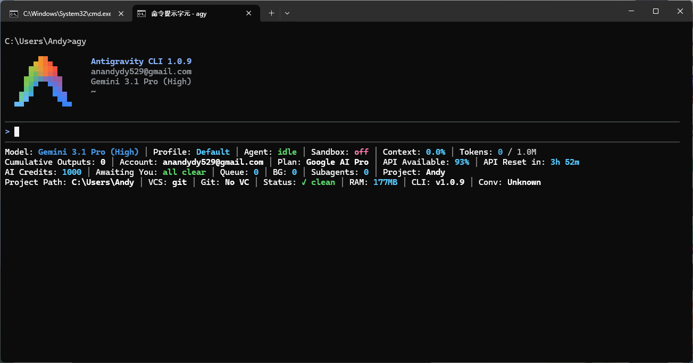
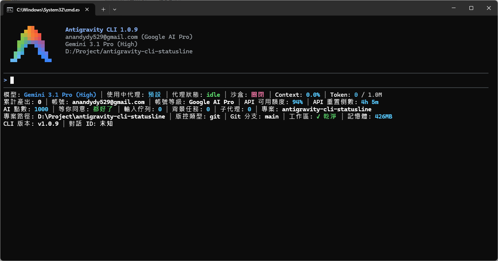
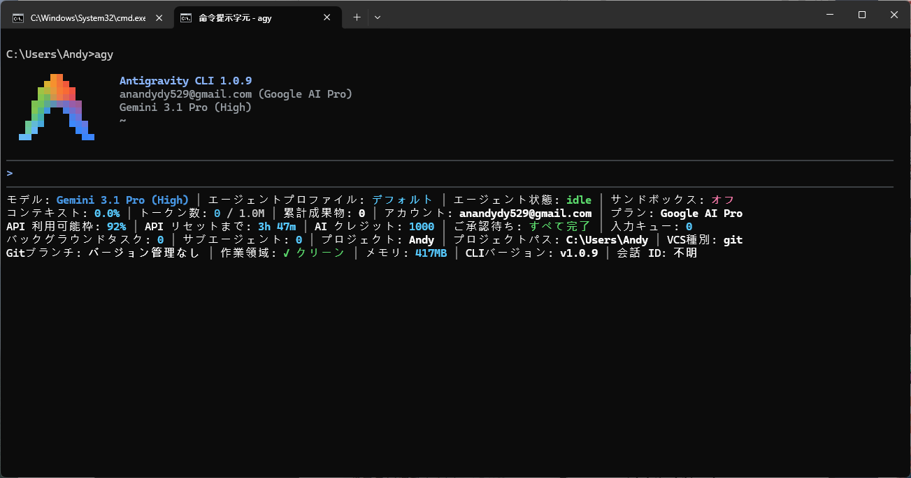
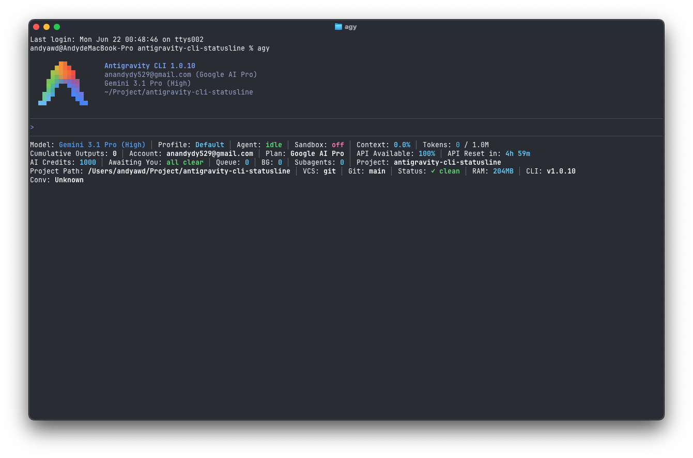
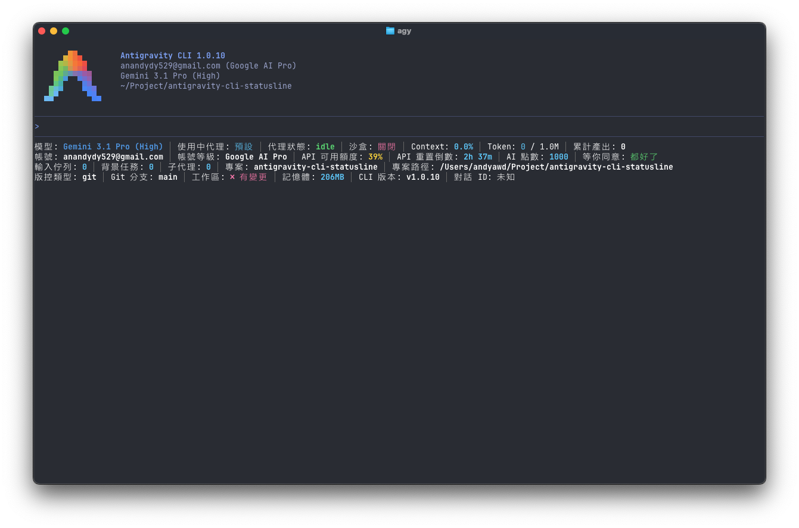
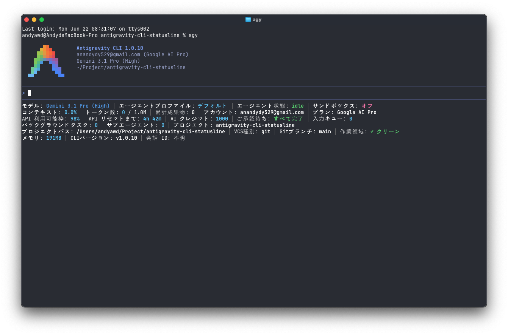

# antigravity-cli-statusline

[English](README.md) | [繁體中文](README.zh-TW.md) | [简体中文](README.zh-CN.md) | 日本語

[](skills/agy-cli-statusline/SKILL.md)
[](LICENSE)
[]()

**Antigravity CLI（`agy`）** と **Antigravity App（2.0、`v2.34.0+`）** の両環境に向けて設計されたリアルタイムテレメトリ＆ステータスラインプラグインです。36種類の指標（AI モデルと Orchestrator 実行中実モデルの追跡、5時間／週間クォータ、コンテキストトークン内訳、Git/VCS 状態、エージェント活動、CLI・2.0 デュアルバージョン）を監視し、テキスト（`text`）と絵文字（`emoji`）スタイルを項目ごとに自由に混在させ、Antigravity 2.0 でのドラッグ＆ドロップ編集または CLI の 7 ステップウィザードでレイアウトを4言語（`us`、`zh-tw`、`zh-cn`、`jp`）にてカスタマイズできます。

Windows、macOS、Linux の各環境で Google Antigravity の 3 大サーフェス（Antigravity CLI、Antigravity IDE サイドバーチャット、Antigravity 2.0 デスクトップアプリケーション）を包括的にサポートします。

## ステータスライン設定とリアルタイムテレメトリの動作デモ

<p align="center">
  
</p>

設定コマンド `/antigravity-cli-statusline:agy-cli-statusline` の実行から、5 大カテゴリ別の指標選択、カスタム並び替え入力、そして複数行の高情報密度ステータスラインによるリアルタイムテレメトリ表示までの CLI フローを収録した動的デモです。

### 実際の画面スクリーンショット

#### Windows

| 英語 (us) | 繁体字中国語 (zh-tw) | 簡体字中国語 (zh-cn) | 日本語 (jp) |
| :---: | :---: | :---: | :---: |
|  |  | *(zh-cn モード対応)* |  |

#### macOS

| 英語 (us) | 繁体字中国語 (zh-tw) | 簡体字中国語 (zh-cn) | 日本語 (jp) |
| :---: | :---: | :---: | :---: |
|  |  | *(zh-cn モード対応)* |  |

## 主な機能

1. **デュアル環境ネイティブ体験（Antigravity 2.0 ビジュアルパネル ＋ CLI ターミナル）**：
   - **Antigravity 2.0（MCP Apps）**：`ui://statusline/app.html` により `npm install` 不要で即座に利用可能。右補助ペインとフルページ表示に対応し、行ベースのドラッグ＆ドロップレイアウト編集、リアルタイム値プレビュー付き 5 カテゴリ 36 指標ドロワー、折りたたみ可能な `tokenBreakdown` 積上げバー、自動追従／固定セッション切替、1 秒カウントダウン、旧版並び順インポート／エクスポート、および指標を途中で分断しないコンパクト自動折り返しを備えています。
   - **Antigravity CLI（`agy`）**：7 ステップのページネーション対話ウィザード、ターミナル幅対応のスマート折り返し、設定変更時の即時ホットリロードを提供。
2. **36種類のリアルタイム指標、4言語＆デュアルラベルスタイル**：AI モデル状態（Orchestrator 利用時は `model-name` に外側のラッパー名を維持しつつ、`active-model` で `プランナー`／`エグゼキューター` ロールの実モデルをリアルタイム追跡し、単一モデル時は赤色で `オフ` 表示）、API クォータ（5時間、週間の 2 系統プール、4 層動的クォータプール帰属解決および 60 秒失効猶予期間のカウントダウン再計算に対応）、コンテキスト／トークン消費量、対話キュー、Git/VCS 状態、システムリソース、さらに CLI と 2.0 の双方から両バージョンを自動検出するデュアルバージョン表示を英語（`us`）、繁体字中国語（`zh-tw`）、簡体字中国語（`zh-cn`）、日本語（`jp`）で提供し、項目ごとに**テキスト（`text`）**または**絵文字（`emoji`）**スタイルを指定できます。
3. **柔軟なバーグラフ表示（結合または個別）**：5時間クォータ、週間クォータ、コンテキスト使用量、セッショントークンに対してデフォルト 10 マスのプログレスバー（`[████████░░]`）を描画。数値指標と隣接しスタイルが一致する場合は自動結合し、離れている場合やスタイルが異なる場合は独立表示します。
4. **カスタム並び替え＆デュアル改行メカニズム**：1 始まりの数字インデックスおよび英字識別子、個別スタイルプレフィックス（`t` / `e`）、`n` による手動改行、`n,n` による空白行区切りに対応し、ターミナル幅と 2.0 パネル幅の双方で指標単位の自動折り返しを行います。
5. **24ビット4段階カラーコーディング**：残量・圧迫度に応じて 4 つのしきい値（`#57caff` 青 `100–75%`、`#5cdb6d` 緑 `74–50%`、`#ffd427` 黄 `49–25%`、`#ff7daf` 赤 `24–0%`）へ動的に変化し、各 AI モデルファミリー専用のブランドアクセントカラーも適用されます。
6. **環境間設定同期、スマートフック保守＆セキュリティ境界**：
   - CLI と 2.0 で 4 層コンテキスト上限計算、Language Server RPC テレメトリ解析、設定書込・フック配置コアを統一し、厳格な CSP とワークスペースパス許可リストを実装。
   - Antigravity 2.0 の初回起動時に既存の CLI `settings.json` レイアウトを自動継承し、「2.0 パネルのみ適用」と「2.0 ＋ CLI に同期適用」の 2 つの保存モードを提供。CLI 同期時には古いバージョンまたはハッシュ不一致の既存 CLI フックスクリプトを自動更新します（既存の `statusLine` コマンドは上書きせず、最新・上位版・未配置時はスキップ）。
   - CLI 側では CLI 固有・グローバル・ワークスペースの 3 層 `settings.json` と `trusted_hooks.json` を同期し、macOS/Linux の NVM パス解決と Windows の UTF-8 BOM 防止を自動処理。
7. **非侵入的な更新チェック**：`ui.footer.items` で `plugin-update`（`#35`）が有効な場合、対話型 `agy` 起動ごとに 1 回だけ GitHub Releases を確認し（`agy -p` はスキップ）、最新時は自動非表示かつ先頭・末尾の純粋な空白行をトリム、オフライン時はキャッシュ済み情報で比較し、古い場合は配置位置に 2 行の更新案内（絵文字スタイルでは `🆕 vX → vY`）を表示します（バージョン表示専用の `plugin-version` `#34` とは完全に分離）。`diagnose-statusline.mjs` でプラグインとフックのバージョン整合性をいつでも確認できます。

## インストール方法

Antigravity コマンドラインインターフェース（CLI）を使用してグローバルにインストールします：

```bash
agy plugin install https://github.com/AndyAWD/antigravity-cli-statusline
```

### 前提条件

- **Node.js**（必須）：レンダラーおよび MCP スクリプトは純粋な `.mjs` で記述されています。Node.js がない場合、CLI ステータスラインは空白のままとなり、30 回連続で失敗すると `agy` によって自動無効化されます。CLI スキルは設定書き込み前に Node.js の利用可否を事前確認します。
- **Git**（任意）：`git-branch`、`vcs-dirty`、`vcs-type` 指標の表示に必要です。

### 有効化の挙動

- **Antigravity App（2.0、`v2.34.0+`）**：インストール後 **`npm install` 不要**で即座に動作します。**Overview > Plugins > Statusline**、サイドバーの **`+`** メニュー（右補助ペイン）、または左ナビゲーションバーの **Plugins > Statusline**（フルページ）から開けます。初回起動時に既存の CLI `settings.json` レイアウトを自動継承し、「2.0 ＋ CLI に同期適用」で保存すると古い既存 CLI フックスクリプトも自動更新されます。
- **初回有効化（CLI）**：CLI ステータスラインを初めて有効化する場合は、`agy` 上で `configure-statusline.mjs` が出力する `/statusline <command>` を入力して即座に有効化するか、`agy` CLI を再起動（一度終了して再度開く）してフックを読み込んでください。
- **ホットリロード（CLI）**：一度有効化された後は、指標の並び順、ラベルスタイル（`text` / `emoji`）、表示言語の変更が CLI を再起動することなく即座に反映されます。

## コマンドとスキル

インストール後、ご利用の環境に応じたスラッシュコマンドを実行してください：

### 1. ビジュアルステータスラインパネルを開く（Antigravity 2.0 App）

```text
/antigravity-cli-statusline:agy-app-statusline
```

- **使用するタイミング**：Antigravity App（`v2.34.0+`）で右補助ペインに **Statusline** ライブモニター＆ドラッグ＆ドロップ編集パネルを直接開くとき（`ask_question` 対話は不要）。**Overview > Plugins > Statusline**、サイドバーの **`+`** メニュー、左ナビゲーションバーの **Plugins > Statusline**（フルページ）からもいつでも開けます。
- **CLI での挙動**：Antigravity CLI（`agy`）から呼び出した場合、`statusline_dashboard` ツールはプレーンテキストのステータス要約を返し、CLI フッター設定用に `/antigravity-cli-statusline:agy-cli-statusline` を案内します。

### 2. CLI ステータスラインの設定（Antigravity CLI）

```text
/antigravity-cli-statusline:agy-cli-statusline
```

- **使用するタイミング**：初めて CLI ステータスラインを有効化するとき、表示言語（`us` / `zh-tw` / `zh-cn` / `jp`）やラベルスタイル（`text` / `emoji`）を切り替えるとき、指標を選択または複数行レイアウトをカスタマイズするとき。
- **動作の仕組み**：
  1. 表示言語の選択を求め、セッション出力をそのロケールに固定します。
  2. Node.js 環境の利用可否を事前検証します（3 層の `settings.json` 読み書きはすべてステップ 5 の `configure-statusline.mjs` 経由で安全に処理され、`~/.gemini/` へ直接アクセスしません）。
  3. `questions.json` から 5 つのカテゴリ別タブにわたって指標選択を順次プロンプトし、ターミナル画面の高さ制限による切り捨てを防ぎます。
  4. 選択された指標を 3 列の簡潔な表で提示し、個別スタイルプレフィックス付きのカスタム並び順を受け付け（純粋な数字、`t` テキストプレフィックス、`e` 絵文字プレフィックス、`n` 改行トークンに対応）、3 層すべての `settings.json` に `ui.footer.items` と `ui.footer.itemStyles` を書き込み、フックスクリプト、4 層 `lib/` モジュール、および `.hook-version.json` SHA-256 マニフェストを `~/.gemini/antigravity-cli/hooks/` に配置して検証します。
  5. 完了時に、前回および今回のレイアウト順序文字列をコードブロックで自動出力し、将来の再利用を容易にします。

## プラグイン管理

- インストール済みプラグインの一覧表示：

  ```bash
  agy plugin list
  ```

- プラグインの有効化：

  ```bash
  agy plugin enable antigravity-cli-statusline
  ```

- プラグインの無効化：

  ```bash
  agy plugin disable antigravity-cli-statusline
  ```

- プラグインのアンインストール：

  ```bash
  agy plugin uninstall antigravity-cli-statusline
  ```

## ディレクトリ構造

```text
antigravity-cli-statusline/
├── plugin.json                                     # Antigravity プラグインマニフェスト
├── mcp_config.json                                 # Antigravity 2.0 MCP サーバー設定
├── hooks.json                                      # ライフサイクルフック（SessionStart/PreInvocation/PostInvocation/Stop）
├── package.json                                    # パッケージメタデータ・npm スクリプト
├── LICENSE                                         # MIT ライセンス
├── CONTRIBUTING.md                                 # 3言語コントリビューションガイド
├── README.md / README.zh-TW.md / README.zh-CN.md / README.ja.md
├── assets/
│   └── logo.svg                                    # Antigravity App プラグインアイコン
├── docs/
│   ├── ARCHITECTURE_HANDOVER.md                    # 4層アーキテクチャ引き継ぎ・拡張ガイド
│   ├── images/                                     # スクリーンショット・生成デモ SVG
│   └── workshop/                                   # ワークショップ資料・アセット
├── src/app/                                        # Antigravity 2.0 MCP App フロントエンドソース（esbuild）
├── scripts/
│   ├── build-app.mjs                               # src/app/ を単一ファイル scripts/mcp/statusline-app.html にビルド
│   ├── hooks/record-session.mjs                    # ライフサイクルフック記録スクリプト（${PLUGIN_DATA} 隔離）
│   ├── mcp/                                        # MCP サーバー、LS テレメトリ、履歴読取・CLI 連携
│   └── tests/                                      # Antigravity 2.0 Hook・MCP・同期契約テスト
└── skills/
    ├── agy-app-statusline/
    │   └── SKILL.md                                # Antigravity 2.0 ビジュアルパネル入口
    └── agy-cli-statusline/
        ├── SKILL.md                                # CLI 7ステップウィザード入口
        ├── references/                             # 技術仕様・設定・Windows・落とし穴ドキュメント
        ├── resources/                              # 自動生成の4言語 UI テンプレート・5カテゴリ設問
        └── scripts/                                # CLI statusLine フック・4層ゼロ依存 ESM モジュール
```

---

## 指標、並び替え＆改行

### 利用可能な指標（1–36）

以下の番号は、ステップ 3（`resources/questions.json`）の 5 カテゴリにわたる 1 始まりの選択肢インデックス、および `emoji` モードで使用される絵文字プレフィックスに対応しています：

**1. モデルと代理（5項目）**
- `1.` 🤖 **AIモデル名（`model-name`）** — 現在の会話を担当している人工知能モデル（Orchestrator 利用時は `Orchestrator (Neon)` など外側のラッパー名を表示）
- `2.` 🪪 **エージェントプロファイル（`agent-profile`）** — 読み込まれているエージェントプロファイル名
- `3.` ⚡ **エージェント状態（`agent-state`）** — `idle / thinking / working / tool_use / initializing`
- `4.` ⚙️ **実行モード（`mode`）** — `default / code-only / plan / interactive / accept-edits`
- `5.` 🪄 **Orchestrator 実行中の実モデル（`active-model`）** — Orchestrator 利用時に現在の実モデルとロール（テキストは `プランナー:`／`エグゼキューター:`、絵文字は `🪄 プランナー →`／`🪄 エグゼキューター →`、ルーティング待機中は `Orchestrator: 待機中`）をリアルタイム表示、単一モデル時は赤色で `オフ` を表示

**2. クォータ、課金とアカウント（10項目）**
- `6.` 🔋 **5時間利用可能クォータ（`quota`）** — 5時間 API 残量パーセンテージ、4段階カラー表示
- `7.` 🔋 **5時間利用可能クォータバーグラフ（`quota-bar`）** — 10マスの5時間クォータバー（`[████████░░]`）
- `8.` ⏳ **5時間クォータリセットカウントダウン（`quota-reset-countdown`）** — 5時間クォータ更新までの残り時間
- `9.` 🕒 **5時間リセット時刻（`quota-reset-time`）** — ローカルタイムゾーンでのリセット時刻（同日なら `HH:mm`、日を跨ぐ場合は `yyyy/MM/dd HH:mm`）
- `10.` 📅 **週間利用可能クォータ（`quota-weekly`）** — 週間 API 残量パーセンテージ、4段階カラー表示
- `11.` 📅 **週間利用可能クォータバーグラフ（`quota-weekly-bar`）** — 10マスの週間クォータバー（`[███████░░░]`）
- `12.` ⏲️ **週間クォータリセットカウントダウン（`quota-weekly-countdown`）** — 週間クォータ更新までの残り時間
- `13.` 🗓️ **週間リセット時刻（`quota-weekly-reset-time`）** — 週間ローカルリセット時刻（例: `2026/10/18 16:00`）
- `14.` 💎 **加入プラン（`plan-tier`）** — 現在のサブスクリプションプランレベル
- `15.` 📧 **アカウントメール（`account-email`）** — ログイン中のアカウントメールアドレス

**3. コンテキストとトークン（4項目）**
- `16.` 🧠 **コンテキスト使用量（`context-used`）** — 消費されたコンテキストウィンドウの割合
- `17.` 🧠 **コンテキスト使用量バーグラフ（`context-used-bar`）** — 10マスのコンテキスト消費バー（`[█░░░░░░░░░]`）
- `18.` 💰 **トークン数（`token-count`）** — 現在のセッションで消費された正確なトークン数
- `19.` 💰 **トークン数バーグラフ（`token-count-bar`）** — 10マスのトークン消費バー（`[█░░░░░░░░░]`）

**4. ワークスペースと VCS（5項目）**
- `20.` 📁 **ワークスペース名（`project-path`）** — 現在のワークスペースディレクトリ名
- `21.` 📍 **ワークスペース絶対パス（`project-full-path`）** — ワークスペースの絶対ディレクトリパス
- `22.` 🔀 **Git ブランチ（`git-branch`）** — 現在のアクティブなブランチ名
- `23.` 🔍 **VCS 変更状態（`vcs-dirty`）** — `未コミット / 変更なし`
- `24.` 🗃️ **VCS 種別（`vcs-type`）** — `git / jj / fig`

**5. システム状態とバックグラウンドタスク（12項目）**
- `25.` 💾 **CLI メモリ使用量（`memory-usage`）** — `agy` プロセスが消費している RSS メモリ
- `26.` 🚀 **Antigravity CLI バージョン（`cli-version`）** — インストール済みの `agy` CLI バージョン（テキスト表示ラベル：`Agy CLI バージョン:`；CLI と 2.0 の両方で自動検出）
- `27.` 💬 **会話番号（`conversation-id`）** — デバッグ用の会話識別子の先頭8文字
- `28.` 🛡️ **サンドボックス状態（`sandbox-status`）** — `オフ / オン（ネット） / オン（オフライン）`
- `29.` 🔔 **ツール承認待ち（`tool-confirmation`）** — ツール確認ダイアログの応答待ち状態
- `30.` 📥 **保留中の入力（`pending-input`）** — 実行待ちのユーザー入力キュー
- `31.` 🔄 **実行中バックグラウンドタスク（`background-tasks`）** — 稼働中のバックグラウンドタスク数
- `32.` 👥 **アクティブなサブエージェント（`subagents`）** — 稼働中のサブエージェント数
- `33.` 📄 **成果物数（`artifacts`）** — このセッションで生成された累積ファイル・成果物数
- `34.` 🧩 **ステータスライン版（`plugin-version`）** — インストール済みの `antigravity-cli-statusline` バージョン表示のみ（更新確認・通知は行いません）
- `35.` 🆕 **ステータスライン更新通知（`plugin-update`）** — 対話型 `agy` 起動ごとに1回 GitHub Releases を確認し（`agy -p` はスキップ）、最新時は自動非表示、古い場合は配置位置に2行の更新案内を表示
- `36.` 💻 **Antigravity 2.0 アプリバージョン（`app-version`）** — インストール済みの Antigravity 2.0 デスクトップアプリのバージョン（テキスト表示ラベル：`Agy 2.0 バージョン:`；CLI と 2.0 の両方で自動検出）

### 並び替えルールとスタイル設定

CLI ウィザードのステップ 4 入力欄（または Antigravity 2.0 パネルの並び順インポート／エクスポート欄）にカンマ区切りで指標インデックスを入力することで、レイアウトと個別スタイルをカスタマイズできます（指定されなかった指標は非表示となり、空欄またはスキップ時は元の選択順・デフォルトテキストスタイルを維持します）：

- **スタイルプレフィックス**：
  - **テキストラベルスタイル（`text`、デフォルト）**：プレーンな数字（例: `1`）、`t` プレフィックス（例: `t1`）、または英字識別子（`quota`、`t:quota`）はローカライズされたテキストラベルとコロンで表示されます（例: `五時間残量: 88%`）。
  - **絵文字ラベルスタイル（`emoji`）**：`e` プレフィックス（例: `e1`、`e:quota`、大文字・小文字不問）でテキストラベルを絵文字とスペース 1 文字に置換します（例: `🔋 88%`）。状態値は選択言語のまま維持されます。
  - **個別混在**：項目ごとに自由に混在可能（例: `e1, 15, e14, 28`）。未指定の項目はテキストスタイルとなります。
- **パーセントバーグラフの結合と個別表示**：
  - 4 組のペア（`quota` `6`+`7`、`quota-weekly` `10`+`11`、`context-used` `16`+`17`、`token-count` `18`+`19`）は、**隣接**配置かつ同一スタイル時に 1 つのラベルへ自動結合されます。
  - 他の指標や改行で**隔てられている**場合やスタイルが競合する場合（テキストと絵文字の混在）は、それぞれ独立して描画されます。
  - デフォルトのバー長は 10 マス（`ui.footer.barLength` で変更可能）、リセット時刻形式は `ui.footer.timeFormat` で設定可能です。
- **改行とセクション区切り**：
  - **手動改行（`n`）**：`n` の位置で強制改行し、連続する `n,n` で空白の区切り行を挿入します。
  - **スマート自動折り返し**：ターミナル幅や 2.0 パネル幅を超える場合、指標単位で自動的に次の行へ折り返します。
- **動的カラー表示**：
  - 24 ビットトゥルーカラーの 4 段階パレット（`#57caff` 青 → `#5cdb6d` 緑 → `#ffd427` 黄 → `#ff7daf` 赤）がクォータ残量やコンテキスト圧迫度に応じて変化し、各 AI モデルファミリー固有のブランドカラーも適用されます。

#### 並び替え入力例

- **英字識別子バージョン**：
  ```text
  e:model-name,active-model,e:account-email,e:plan-tier,e:sandbox-status,n,e:agent-profile,agent-state,subagents,artifacts,pending-input,background-tasks,tool-confirmation,n,n,context-used,context-used-bar,token-count,token-count-bar,n,quota,quota-bar,quota-reset-countdown,quota-reset-time,n,quota-weekly,quota-weekly-bar,quota-weekly-countdown,quota-weekly-reset-time,n,n,vcs-dirty,vcs-type,e:git-branch,n,e:project-path,project-full-path,n,n,e:mode,e:conversation-id,e:memory-usage,cli-version,app-version,plugin-version,n,e:plugin-update
  ```

#### 出力プレビュー（混在モード）

4 つの論理グループ、空行で区切られた計 8 行の情報（最新バージョン時は `e:plugin-update` が自動非表示となり末尾の改行もトリムされます）：

```text
🤖 Orchestrator (Neon) │ プランナー: Gemini 4 Neon (High) │ 📧 anandydy529@gmail.com │ 💎 Google AI Pro │ 🛡️ オフ
🪪 Default │ 状態: 実行中 │ サブ代理: 2 │ 成果物: 0 │ 入力キュー: 0 │ BGタスク: 0 │ ご承認待ち: なし

コンテキスト使用: 18.5% [█░░░░░░░░░] │ トークン: 47.4k / 256.0k [█░░░░░░░░░]
五時間残量: 88% [████████░░] │ 五時間リセット: 4h 50m │ 五時間リセット時刻: 15:50
七日間残量: 78% [███████░░░] │ 七日間リセット: 4d 5h │ 七日間リセット時刻: 2026/10/18 16:00

版管理状態: 変更なし │ 版管理種別: git │ 🔀 main
📁 antigravity-cli-statusline │ パス: /Users/andyawd/Project/antigravity-cli-statusline

⚙️ Accept-edits │ 💬 c5168b1c │ 💾 279MB │ Agy CLI バージョン: v1.5.10 │ Agy 2.0 バージョン: v2.34.0 │ ステータスライン版: v2.1.2
```

`plugin-update`（`#35`）が有効で新しい GitHub Release が利用可能な場合、指定した配置位置に 2 行の更新案内が独立表示されます（ターミナルで `agy plugin install` を実行すると表示バージョンが追いつき警告は消えます。古い CLI フックスクリプトを同期する場合は Antigravity 2.0 の「2.0 ＋ CLI に同期適用」または CLI の `/antigravity-cli-statusline:agy-cli-statusline` を実行するか、`node skills/agy-cli-statusline/scripts/diagnose-statusline.mjs` でバージョン差を確認してください）：

```text
⚠️ ステータスラインの新バージョンが利用可能です（現在 v2.1.1 → 最新 v2.1.2）。以下のコマンドで更新してください：
agy plugin install https://github.com/AndyAWD/antigravity-cli-statusline
```

絵文字スタイル（`e35` / `e:plugin-update`）では、1 行目が `🆕 v2.1.1 → v2.1.2` のコンパクト表示になり、2 行目に更新コマンドが独立出力されます。最新バージョンの場合は自動的に非表示となり、先頭・末尾の純粋な空白行もトリムされます。

## コントリビューション

新しい指標の追加、クロスプラットフォームの修正、言語翻訳など、あらゆる貢献を歓迎します。詳細なワークフローについては [CONTRIBUTING.md](CONTRIBUTING.md) を参照してください。

## 謝辞

- **[60ke/antigravity-statusline](https://github.com/60ke/antigravity-statusline)**：クォータ監視機能のインスピレーションを与えてくださったオリジナルプロジェクトに感謝します。元の実装は Python で記述されており、Windows と macOS の間で一貫して実行することが難しい場合があったため、本プロジェクトは外部の Python 依存関係に頼ることなくシームレスなクロスプラットフォーム互換性を確保するため JavaScript（Node.js）で書き直されました。
- **[ericsk/agy-gcp-companion](https://github.com/ericsk/agy-gcp-companion)**：CLI の下部ステータスラインを Antigravity 2.0 のインタラクティブパネルへ移植する構成は、同プロジェクトのサイドバー設計から直接インスピレーションを得て実装しました。

## ライセンス

[MIT License](LICENSE) © 2026 AndyAWD
