# antigravity-cli-statusline

English | [繁體中文](README.zh-TW.md) | [简体中文](README.zh-CN.md) | [日本語](README.ja.md)

[](skills/agy-cli-statusline/SKILL.md)
[](LICENSE)
[]()

An Antigravity plugin for both **Antigravity CLI (`agy`)** and **Antigravity App (2.0, `v2.34.0+`)** — monitor 40 real-time indicators (model, Orchestrator active model, 5-hour/7-day/Argon quotas, context token breakdown, Git status, agent state, CLI & 2.0 versions), switch between Text (`text`) and Emoji (`emoji`) label styles, arrange items and line breaks visually with drag-and-drop in Antigravity App or via the 7-step CLI wizard, across 4 languages (`us`, `zh-tw`, `zh-cn`, `jp`).

Comprehensive support across the three core platforms of Google Antigravity (AGY): Antigravity Command-Line Interface (CLI) (`agy`), Antigravity Integrated Development Environment (IDE), and Antigravity 2.0 Desktop Application.

## Statusline Setup & Interactive Telemetry in Action

<p align="center">
  
</p>

Live animation demonstrating the complete flow from executing `/antigravity-cli-statusline:agy-cli-statusline`, interactive indicator selection, custom layout input, to the full 11-row telemetry statusline.

## Installation

Install the plugin globally using the Antigravity Command-Line Interface (CLI):

```bash
agy plugin install https://github.com/AndyAWD/antigravity-cli-statusline
```

### Prerequisites

- **Node.js** (required): The renderer scripts are written in pure `.mjs`. Without Node.js, the statusline stays blank and `agy` disables it after 30 consecutive failures. The skill pre-checks Node.js availability before writing configurations.
- **Git** (optional): Required for `git-branch`, `vcs-dirty`, and `vcs-type` indicators.

### Activation Behavior

- **First-Open Enablement (CLI)**: When enabling the CLI statusline for the first time, run `/statusline <command>` (printed by `configure-statusline.mjs`) inside `agy` to activate it immediately, or restart `agy` CLI (exit and reopen) to load the statusline hook.
- **Hot Reload (CLI)**: Once enabled, subsequent changes to indicator ordering, label style (`text` / `emoji`), or display language take effect immediately without restarting the CLI.
- **Antigravity App (2.0, `v2.34.0+`)**: Works out of the box via Model Context Protocol (MCP) Apps (`ui://statusline/app.html`) with **zero `npm install`** required. Open **Statusline** from **Overview > Plugins > Statusline**, the sidebar **`+`** menu (`aux_pane`), or the left navigation bar (`global`). On first run it automatically inherits your existing CLI `settings.json` layout, and lets you save to the 2.0 panel only or sync back to CLI `settings.json` with optional hook deployment.

## Key Features

1. **Multi-Platform Compatibility**: Supports Antigravity CLI terminal, Antigravity IDE sidebar chat, and Antigravity 2.0 Desktop Application across Windows, macOS, and Linux.
2. **40 Real-Time Indicators, 4 Locales & Dual Label Styles**: Provides 40 metrics across model status (including live Orchestrator `Plan` vs. `Work` underlying model tracking), API quotas (including 5-hour, weekly, and Gemini 4 Argon dedicated quota pools with 4-tier dynamic quota pool resolution and live countdown recalculation within a 60s expiry grace period), context/token consumption, interactive queues, Git/VCS state, and system telemetry in English (`us`), Traditional Chinese (`zh-tw`), Simplified Chinese (`zh-cn`), and Japanese (`jp`), with selectable **Text (`text`)** or **Emoji (`emoji`, no-colon compact)** label styles (`ui.footer.labelStyle`).
3. **Flexible Bar Graphs (Merged or Separate)**: Renders 10-block visual progress bars (`[████████░░]`) for 5-hour quota, weekly quota, Gemini 4 Argon quota, context usage, and session tokens. Automatically merges labels when placed adjacent to numeric counterparts, or displays them with independent labels when separated.
4. **Custom Sorting & Dual Line-Wrapping**: Supports 1-based index sorting, `n` manual line breaks, `n,n` blank-line section separators, and terminal-width-aware automatic wrapping.
5. **24-Bit Four-Tier Color Coding**: Shifts colors across 4 thresholds (`#57caff` Blue `100–75%`, `#5cdb6d` Green `74–50%`, `#ffd427` Yellow `49–25%`, `#ff7daf` Pink `24–0%`) alongside model-family brand colors.
6. **Three-Layer Config Sync & OS Safeguards**: Synchronizes CLI-specific, global, and workspace `settings.json` plus `trusted_hooks.json`, while handling macOS/Linux NVM path resolution and Windows UTF-8 Byte Order Mark (BOM) prevention.
7. **First-Open Update Check & Manual Hook Sync**: When `plugin-update` (`#39`) is enabled in `ui.footer.items`, checks GitHub Releases once per interactive `agy` CLI launch (skipping `agy -p`), auto-hides while trimming leading/trailing blank lines when up to date, falls back cleanly to cached release info if offline, and renders a localized 2-line update notice (or concise `🆕 vX → vY` in `emoji` style) at its configured position when outdated—completely decoupled from `plugin-version` (`#38`), which renders the statusline version only without disrupting single-line layouts. Hook sync stays manual via `/antigravity-cli-statusline:agy-cli-statusline`, and `diagnose-statusline.mjs` inspects plugin-vs-hook version alignment.
8. **Native Antigravity 2.0 Visual Panel (MCP Apps)**: Provides an interactive side-panel and full-page dashboard with in-place row-based drag-and-drop layout editing, a 5-category 40-metric drawer with live value previews, collapsible context `tokenBreakdown` stacked bar and usage summary, 1-second live countdowns, legacy order import/export, and dual save buttons (**Apply to 2.0 Panel Only** vs. **Sync to 2.0 + CLI**).

## Plugin Management

• List installed plugins:

  ```bash
  agy plugin list
  ```

• Enable this plugin:

  ```bash
  agy plugin enable antigravity-cli-statusline
  ```

• Disable this plugin:

  ```bash
  agy plugin disable antigravity-cli-statusline
  ```

• Uninstall this plugin:

  ```bash
  agy plugin uninstall antigravity-cli-statusline
  ```

## Project Structure

```text
antigravity-cli-statusline/
├── plugin.json                                     # Antigravity plugin manifest
├── mcp_config.json                                 # MCP server configuration for Antigravity 2.0
├── hooks.json                                      # Lifecycle hooks (SessionStart/PreInvocation/PostInvocation/Stop)
├── package.json                                    # Package metadata & npm scripts
├── LICENSE                                         # MIT License
├── CONTRIBUTING.md                                 # 3-language contributor guide
├── README.md / README.zh-TW.md / README.zh-CN.md / README.ja.md
├── assets/
│   └── logo.svg                                    # Plugin icon for Antigravity App
├── docs/
│   ├── ARCHITECTURE_HANDOVER.md                    # 4-layer architecture & extension guide
│   ├── images/                                     # Screenshots & generated demo SVGs
│   └── workshop/                                   # Workshop slides & assets
├── src/app/                                        # Antigravity 2.0 MCP App frontend source (esbuild)
├── scripts/
│   ├── build-app.mjs                               # Bundles src/app/ into scripts/mcp/statusline-app.html
│   ├── hooks/record-session.mjs                    # Lifecycle hook writer (isolated in ${PLUGIN_DATA})
│   ├── mcp/                                        # MCP server, LS telemetry, transcript reader & CLI bridge
│   └── tests/                                      # Antigravity 2.0 hook, MCP & sync-contract tests
└── skills/
    ├── agy-app-statusline/
    │   └── SKILL.md                                # Antigravity 2.0 visual panel entrypoint
    └── agy-cli-statusline/
        ├── SKILL.md                                # CLI 7-step wizard entrypoint
        ├── references/                             # Technical specs, config, Windows & pitfalls docs
        ├── resources/                              # Generated 4-locale prompts & 5-category questions
        └── scripts/                                # CLI statusLine hook & 4-layer zero-dep ESM modules
```

## Commands and Skills

Once installed, use the command matching your interface:

### 1. Open Visual Statusline Panel (Antigravity 2.0 App)

```text
/antigravity-cli-statusline:agy-app-statusline
```

- **When to Use**: In Antigravity App (`v2.34.0+`) to open the interactive **Statusline** monitor and drag-and-drop layout editor directly in the right auxiliary pane (no `ask_question` prompts). You can also open it anytime from **Overview > Plugins > Statusline** or the left sidebar **Plugins > Statusline** (`global`).

### 2. Configure CLI Statusline (Antigravity CLI)

```text
/antigravity-cli-statusline:agy-cli-statusline
```

- **When to Use**: When enabling the statusline for the first time, switching display language (`us` / `zh-tw` / `zh-cn` / `jp`), switching between Text (`text`) and Emoji (`emoji`) label styles, selecting indicators, or customizing multi-line layout order.
- **How It Works**:
  1. Prompts for display language selection and locks the session output to that locale.
  2. Verifies Node.js environment availability before setup (all three-layer `settings.json` reads and writes are safely delegated to `configure-statusline.mjs` rather than directly editing `~/.gemini/`).
  3. Sequentially prompts for indicator selection across 5 categorized tabs from `questions.json`, avoiding terminal screen height truncation.
  4. Displays selected indicators and accepts a custom sort order with individual style prefixes (supporting plain numbers, `t` text prefix, `e` emoji prefix, and `n` newline tokens), writing `ui.footer.items` and `ui.footer.itemStyles` across all three `settings.json` layers, and deploys hook scripts and the 4-layer `lib/` modules (plus `.hook-version.json` SHA-256 manifest) to `~/.gemini/antigravity-cli/hooks/`.
  5. Upon completion, automatically prints code blocks containing the previous and current layout order strings for easy copy-paste reuse.

---

## Indicators, Sorting & Line Wrapping

### Available Indicators (1–40)

The numbers below correspond to the 1-based option indices across the 5 categories in Step 3 (`resources/questions.json`), along with each indicator's Emoji prefix used in `emoji` mode:

**1. Model & Agent (5 items)**
- `1.` 🤖 **Current AI model name (`model-name`)** — the model serving the current conversation
- `2.` 🪪 **Active agent profile (`agent-profile`)** — the loaded Agent Profile name
- `3.` ⚡ **Agent state (`agent-state`)** — `idle / thinking / working / tool_use / initializing`
- `4.` ⚙️ **Current running mode (`mode`)** — `default / code-only / plan / interactive / accept-edits`
- `5.` 🪄 **Active underlying model under Orchestrator (`active-model`)** — shows the live routed model with dynamic role labels (`Orchestrator Plan:` / `Orchestrator Work:` in `text`, `🪄 Plan →` / `🪄 Work →` in `emoji`), or `off` in red for single-model sessions

**2. Quota, Billing & Account (14 items)**
- `6.` 🔋 **5-hour available quota (`quota`)** — 5-hour API remaining percentage, four-tier color-coded
- `7.` 🔋 **5-hour available quota bar graph (`quota-bar`)** — 10-block 5-hour quota bar (`[████████░░]`)
- `8.` ⏳ **5-hour quota reset countdown (`quota-reset-countdown`)** — time remaining until 5-hour quota refresh
- `9.` 🕒 **5-hour reset time (`quota-reset-time`)** — local timezone reset timestamp (`HH:mm` same day, `yyyy/MM/dd HH:mm` across days)
- `10.` 📅 **Weekly available quota (`quota-weekly`)** — weekly API remaining percentage, four-tier color-coded
- `11.` 📅 **Weekly available quota bar graph (`quota-weekly-bar`)** — 10-block weekly quota bar (`[███████░░░]`)
- `12.` ⏲️ **Weekly quota reset countdown (`quota-weekly-countdown`)** — time remaining until weekly refresh
- `13.` 🗓️ **Weekly reset time (`quota-weekly-reset-time`)** — weekly local reset timestamp (e.g., `2026/10/18 16:00`)
- `14.` ✨ **Gemini 4 Argon available quota (`quota-argon`)** — Gemini 4 Argon dedicated quota percentage, four-tier color-coded
- `15.` ✨ **Gemini 4 Argon quota bar graph (`quota-argon-bar`)** — 10-block Argon quota bar (`[█████░░░░░]`)
- `16.` ⏱️ **Gemini 4 Argon quota reset countdown (`quota-argon-countdown`)** — time remaining until Argon quota refresh
- `17.` ⏰ **Gemini 4 Argon reset time (`quota-argon-reset-time`)** — Argon local reset timestamp (e.g., `2026/10/30 23:57`)
- `18.` 💎 **Subscription plan tier (`plan-tier`)** — current subscription plan level
- `19.` 📧 **Account email (`account-email`)** — logged-in account email address

**3. Context & Tokens (4 items)**
- `20.` 🧠 **Context used percentage (`context-used`)** — percentage of context window consumed
- `21.` 🧠 **Context used bar graph (`context-used-bar`)** — 10-block context consumed bar (`[█░░░░░░░░░]`)
- `22.` 💰 **Exact token count (`token-count`)** — token usage in the current session
- `23.` 💰 **Token count bar graph (`token-count-bar`)** — 10-block token consumed bar (`[█░░░░░░░░░]`)

**4. Workspace & VCS (5 items)**
- `24.` 📁 **Workspace short path (`project-path`)** — current workspace directory basename
- `25.` 📍 **Workspace full path (`project-full-path`)** — absolute workspace directory path
- `26.` 🔀 **Current Git branch (`git-branch`)** — active branch name
- `27.` 🔍 **VCS uncommitted status (`vcs-dirty`)** — `uncommitted / no changes`
- `28.` 🗃️ **VCS type (`vcs-type`)** — `git / jj / fig`

**5. System Status & Background Tasks (12 items)**
- `29.` 💾 **CLI RAM usage (`memory-usage`)** — RSS memory consumed by the `agy` process
- `30.` 🚀 **Antigravity CLI version (`cli-version`)** — installed `agy` CLI version string (`Agy CLI Version:` in text mode; works in both CLI and Antigravity 2.0)
- `31.` 💬 **Conversation ID (`conversation-id`)** — first 8 characters of conversation ID for debugging
- `32.` 🛡️ **Sandbox status (`sandbox-status`)** — `off / on (net) / on (no-net)`
- `33.` 🔔 **Pending tool confirmation (`tool-confirmation`)** — whether a tool confirmation dialog is awaiting response
- `34.` 📥 **Pending user inputs (`pending-input`)** — queued user inputs waiting to run
- `35.` 🔄 **Running background tasks (`background-tasks`)** — active background task count
- `36.` 👥 **Active subagents (`subagents`)** — running subagent count
- `37.` 📄 **Total artifacts (`artifacts`)** — cumulative files/outputs produced in this session
- `38.` 🧩 **Statusline version (`plugin-version`)** — displays installed `antigravity-cli-statusline` version only (`Statusline Version:` in text mode; does not trigger update checks or reminders)
- `39.` 🆕 **Statusline update reminder (`plugin-update`)** — checks GitHub Releases once per interactive `agy` launch (skipping `agy -p`), auto-hides when up to date, and renders a 2-line update command at its configured position when behind
- `40.` 💻 **Antigravity 2.0 App version (`app-version`)** — installed Antigravity 2.0 desktop app version (`Agy 2.0 Version:` in text mode; works in both CLI and Antigravity 2.0)

### Sorting Rules & Style Configuration

In Step 4 of the skill workflow, enter a comma-separated list of indicator indices in the Write-in box to customize the layout and individual styles (unlisted indicators are excluded; leaving blank or choosing Skip keeps the original selection with default text style):

- **Style Prefixes**:
  - **Text label style (`text`, default)**: Plain numbers (e.g., `1`), `t` prefix (e.g., `t1`), or plain English IDs (`quota`, `t:quota`) format as localized text labels with colons (e.g., `5-hr Available: 88%`).
  - **Emoji icon style (`emoji`)**: Use an `e` prefix (e.g., `e1`, `e:quota`, case-insensitive) to replace text labels with the indicator's Emoji icon and a single space (e.g., `🔋 88%`), while keeping status values localized.
  - **Mix & Match**: Items can be styled independently (e.g., `e1, 19, e18, 32`), unformatted items default to text style.
- **Percentage Bar Graph Merging & Separation**:
  - For the five indicator pairs (`quota` `6`+`7`, `quota-weekly` `10`+`11`, `quota-argon` `14`+`15`, `context-used` `20`+`21`, `token-count` `22`+`23`), placing a numeric indicator **adjacent** to its corresponding bar graph (e.g., `6,7`) with matching styles automatically merges them under a single label and progress bar.
  - When **separated** (by other indicators or newlines) or when styles conflict (one `text`, one `emoji`), each renders individually with its own label.
  - Default bar length is 10 blocks (`[████████░░]`, configurable via `ui.footer.barLength`), and reset time format is configurable via `ui.footer.timeFormat`.
- **Line Wrapping & Spacing**:
  - **Manual line breaks (`n`)**: Insert `n` to force a newline at that position; consecutive `n,n` inserts a blank line separator.
  - **Smart automatic wrapping**: Automatically wraps to the next line when total width exceeds the terminal window.
- **Dynamic Color Shifts**:
  - 24-bit truecolor four-tier palette (`#57caff` Blue → `#5cdb6d` Green → `#ffd427` Yellow → `#ff7daf` Pink) shifts based on remaining quota or context pressure; each AI model family also applies its brand color.

#### Sort Input Example

- **Numeric Version**:
  ```text
  e1,e19,e18,e32,n,e2,3,36,37,34,35,33,n,n,20,21,22,23,n,6,7,8,9,n,10,11,12,13,n,14,15,16,17,n,n,27,28,e26,n,e24,25,n,e4,e31,e29,30,38,n,n,e39
  ```

- **Identifier Version**:
  ```text
  e:model-name,e:account-email,e:plan-tier,e:sandbox-status,n,e:agent-profile,agent-state,subagents,artifacts,pending-input,background-tasks,tool-confirmation,n,n,context-used,context-used-bar,token-count,token-count-bar,n,quota,quota-bar,quota-reset-countdown,quota-reset-time,n,quota-weekly,quota-weekly-bar,quota-weekly-countdown,quota-weekly-reset-time,n,quota-argon,quota-argon-bar,quota-argon-countdown,quota-argon-reset-time,n,n,vcs-dirty,vcs-type,e:git-branch,n,e:project-path,project-full-path,n,e:mode,e:conversation-id,e:memory-usage,cli-version,plugin-version,n,n,e:plugin-update
  ```

*(Note: English identifiers such as `model-name` or `e:quota` are also supported, but numeric indices are recommended for conciseness.)*

#### Output Preview (Mixed Mode)

4 logical groups across 9 content lines separated by blank lines (when up to date, `e:plugin-update` hides automatically and trims the trailing blank lines):

```text
🤖 Gemini 3.8 Flash (High) │ 📧 anandydy529@gmail.com │ 💎 Google AI Pro │ 🛡️ off
🪪 Default │ Agent: working │ Subagents: 2 │ Outputs: 0 │ Queue: 0 │ BG: 0 │ Awaiting You: none

Context Used: 18.5% [█░░░░░░░░░] │ Tokens: 47.4k / 256.0k [█░░░░░░░░░]
5-hr Available: 88% [████████░░] │ 5-hr Reset: 4h 50m │ 5-hr Reset Time: 15:50
7-day Available: 78% [███████░░░] │ 7-day Reset: 4d 5h │ 7-day Reset Time: 2026/10/18 16:00
Argon Available: 59% [█████░░░░░] │ Argon Reset: 6d 1h │ Argon Reset Time: 2026/10/30 23:57

VCS Status: no changes │ VCS: git │ 🔀 main
📁 antigravity-cli-statusline │ Project Path: /Users/andyawd/Project/antigravity-cli-statusline
⚙️ Accept-edits │ 💬 c5168b1c │ 💾 279MB │ Agy CLI Version: v1.5.10 │ Statusline Version: v1.13.0
```

When a newer GitHub Release is available, `e:plugin-update` appends two standalone notice lines after the blank line (the warning disappears automatically after running `agy plugin install` in your terminal; run `/antigravity-cli-statusline:agy-cli-statusline` afterward if you want to sync hook scripts in `~/.gemini/antigravity-cli/hooks/`, or inspect status with `node skills/agy-cli-statusline/scripts/diagnose-statusline.mjs`):

```text
🆕 v1.12.0 → v1.13.0
agy plugin install https://github.com/AndyAWD/antigravity-cli-statusline
```

*(In Text style `39` / `plugin-update`, the first line renders as `⚠️ Statusline update available (current v1.12.0 → latest v1.13.0). Run to update:`.)*

## Contributing

Contributions are welcome — including new indicators, cross-platform fixes, and language translations. See [CONTRIBUTING.md](CONTRIBUTING.md) for detailed project structure and workflow.

## Acknowledgements

Special thanks to [60ke/antigravity-statusline](https://github.com/60ke/antigravity-statusline) for the inspiration behind the quota monitoring feature. Their original project paved the way for statusline integrations. Since their implementation was written in Python, which could be challenging to execute consistently across Windows and macOS, this project was rewritten in JavaScript (Node.js) to ensure seamless cross-platform compatibility without relying on external Python dependencies.

## License

This project is licensed under the MIT License. See the [LICENSE](LICENSE) file for details.
