# antigravity-cli-statusline

[English](README.md) | [繁體中文](README.zh-TW.md) | 简体中文 | [日本語](README.ja.md)

[](skills/agy-cli-statusline/SKILL.md)
[](LICENSE)
[]()

一个专为 Google Antigravity（AGY）设计的插件（Plugin），用于自定义 Antigravity 命令行界面（Command-Line Interface）（`agy`）的状态栏（Statusline / Footer）——支持从 36 项实时指标中自由勾选、切换文字（`text`）或表情符号（Emoji）（`emoji`）标签显示风格、自定义排序、切换百分比长条图的合并或分开显示模式，并内置自动与手动换行机制，提供 4 种显示语言（`zh-tw`、`zh-cn`、`us`、`jp`）。

全面支持 Google Antigravity 的三大核心平台：Antigravity 命令行界面（`agy`）、Antigravity 集成开发环境（Integrated Development Environment）以及 Antigravity 2.0 桌面应用程序。

## 状态栏实际运作展示

<p align="center">
  
</p>

动态展示从执行设置指令 `/antigravity-cli-statusline:agy-cli-statusline`、问卷交互选取指标、自定义排序输入，到最终呈现 11 列高信息密度状态栏的完整实时遥测流程。

## 如何安装

通过 Antigravity 命令行界面进行全局安装：

```bash
agy plugin install https://github.com/AndyAWD/antigravity-cli-statusline
```

### 环境要求

- **Node.js**（必需）：渲染脚本以纯 `.mjs` 编写；若系统未安装 Node.js，状态栏将保持空白，且 `agy` 会在连续失败 30 次后自动禁用状态栏。本技能在写入配置前会先进行环境预检。
- **Git**（可选）：用于读取 `git-branch`、`vcs-dirty`、`vcs-type` 等版本控制系统（Version Control System）指标。

### 启用与生效机制

- **初次启用**：初次安装或初次启用状态栏时，`agy` 命令行界面不会在运行期间动态载入新增的挂钩（Hook）进程，请重新启动 `agy` 命令行界面（退出后重新打开）以载入状态栏。
- **热更新（Hot Reload）生效**：此前已启用状态栏者，后续调整指标顺序、切换标签显示风格（`text` / `emoji`）或切换语言时，状态栏会直接热更新生效，无需重新启动命令行界面。

## 特色亮点

1. **跨平台兼容**：支持 Antigravity 命令行界面终端、集成开发环境侧边栏对话框（Dialog Box）以及 Antigravity 2.0 桌面应用程序，覆盖 Windows、macOS 与 Linux 操作系统。
2. **36 项实时指标、4 种语言与双标签显示风格**：涵盖人工智能（Artificial Intelligence）模型状态、应用程序接口（Application Programming Interface）配额（含五小时、每周与 Gemini 4 Argon 专属配额）、上下文（Context）与令牌（Token）消耗、交互队列、Git 版本控制状态及系统资源，支持简体中文（`zh-cn`）、繁体中文（`zh-tw`）、英文（`us`）与日文（`jp`），并可自由切换**文字标签（`text`）**或**表情符号标签（`emoji`，无冒号精简排版）**显示风格（`ui.footer.labelStyle`）。
3. **灵活百分比长条图（支持合并与分开显示）**：针对五小时额度、每周额度、Gemini 4 Argon 额度、上下文用量与令牌数提供默认 10 格视觉长条图（`[████████░░]`）；当数值与长条图相邻时自动合并为单一标签，未相邻时则各自以独立标签显示。
4. **自定义排序与双轨换行机制**：支持以数字序号或英文标识码（Identifier）排序、使用 `n` 强制换行、使用 `n,n` 创建空白分隔行，并依终端宽度自动智能折行。
5. **24-bit 四阶动态色彩**：依据配额剩余比例或上下文消耗程度自动切换 4 个色阶（`#57caff` 蓝色 `100~75%`、`#5cdb6d` 绿色 `74~50%`、`#ffd427` 黄色 `49~25%`、`#ff7daf` 粉红色 `24~0%`），并为不同人工智能模型家族应用专属品牌识别色。
6. **三层配置文件同步与系统防护**：自动同步命令行界面专属、全局与项目三层 `settings.json` 及 `trusted_hooks.json`，内置 macOS/Linux NVM 绝对路径解析与 Windows UTF-8 字节顺序标记（Byte Order Mark）自动剥除机制。

## 如何管理与切换插件

```bash
# 列出已安装插件
agy plugin list

# 启用插件
agy plugin enable antigravity-cli-statusline

# 停用插件
agy plugin disable antigravity-cli-statusline

# 移除插件
agy plugin uninstall antigravity-cli-statusline
```

## 命令与技能说明

安装完成后，可在任何 AGY 界面通过语义对话或输入对应的斜线命令（Slash Command）触发：

### 状态栏设置技能（Configure Statusline）

```text
/antigravity-cli-statusline:agy-cli-statusline
```

- **使用场景**：初次启用命令行界面状态栏、切换显示语言（`zh-tw` / `zh-cn` / `us` / `jp`）、切换文字（`text`）或表情符号（`emoji`）标签显示风格、增减显示指标，或重新调整多行排版顺序时。
- **运作流程**：
  1. 询问显示语言，并将后续所有设置交互锁定为所选语言。
  2. 执行 Node.js 环境预检，并读取命令行界面专属、全局与项目三层 `settings.json` 状态。
  3. 载入 `questions.json` 以五大分类分页依序提供指标勾选，避开终端屏幕高度截断问题。
  4. 列出用户所选指标，接收自定义排序与个别样式前缀（支持纯数字、`t` 文字前缀、`e` 表情符号前缀与 `n` 换行符号），将 `ui.footer.items` 与 `ui.footer.itemStyles` 写入三层 `settings.json`，并将挂钩脚本部署至 `~/.gemini/antigravity-cli/hooks/` 完成测试验证。
  5. 设置完成后，自动以代码块回报先前与本次的排版顺序字符串，方便随时复制粘贴重现设置。

---

## 指标、排序与换行

### 可显示的指标（1–36）

以下编号对应技能步骤 3 问卷（`resources/questions.json`）中五大分类分页选项序号（从 1 起算），以及各指标在 `emoji` 模式下对应的表情符号：

**1. 模型与代理（4 项）**
- `1.` 🤖 **当前使用的人工智能模型名称（`model-name`）**：实时显示对话正在使用的模型
- `2.` 🪪 **使用中代理（`agent-profile`）**：当前加载的 Agent Profile 名称
- `3.` ⚡ **代理当前状态（`agent-state`）**：`闲置 / 思考中 / 执行中 / 调用工具 / 初始化`
- `4.` ⚙️ **当前运行模式（`mode`）**：`default / code-only / plan / interactive / accept-edits`

**2. 额度、计费与账号（14 项）**
- `5.` 🔋 **账号五小时可用额度百分比（`quota`）**：五小时应用程序接口可用额度百分比，搭配四阶配色
- `6.` 🔋 **五小时可用额度长条图（`quota-bar`）**：10 格五小时可用额度长条图（`[████████░░]`）
- `7.` ⏳ **账号五小时额度重置时间倒计时（`quota-reset-countdown`）**：距离五小时额度重置的剩余时间
- `8.` 🕒 **五小时重置时间（`quota-reset-time`）**：本机时区绝对重置时间（默认同日 `HH:mm`、跨日 `yyyy/MM/dd HH:mm`）
- `9.` 📅 **账号每周可用额度百分比（`quota-weekly`）**：每周应用程序接口可用额度百分比，搭配四阶配色
- `10.` 📅 **每周可用额度长条图（`quota-weekly-bar`）**：10 格每周可用额度长条图（`[███████░░░]`）
- `11.` ⏲️ **账号每周额度重置时间倒计时（`quota-weekly-countdown`）**：距离每周额度重置的剩余时间
- `12.` 🗓️ **每周重置时间（`quota-weekly-reset-time`）**：每周额度重置的本机绝对时间（如 `2026/10/18 16:00`）
- `13.` ✨ **Gemini 4 Argon 可用额度百分比（`quota-argon`）**：Gemini 4 Argon 专属配额百分比，搭配四阶配色
- `14.` ✨ **Gemini 4 Argon 可用额度长条图（`quota-argon-bar`）**：10 格 Argon 可用额度长条图（`[█████░░░░░]`）
- `15.` ⏱️ **Gemini 4 Argon 额度重置时间倒计时（`quota-argon-countdown`）**：距离 Argon 额度重置的剩余时间
- `16.` ⏰ **Gemini 4 Argon 重置时间（`quota-argon-reset-time`）**：Argon 额度重置的本机绝对时间（如 `2026/10/30 23:57`）
- `17.` 💎 **当前订阅计划等级（`plan-tier`）**：当前账号的订阅等级
- `18.` 📧 **账号电子邮件（`account-email`）**：当前登录的账号邮箱

**3. 上下文与令牌（4 项）**
- `19.` 🧠 **当前对话已消耗的上下文用量比例（`context-used`）**：上下文窗口已消耗百分比
- `20.` 🧠 **上下文用量长条图（`context-used-bar`）**：10 格上下文消耗长条图（`[█░░░░░░░░░]`）
- `21.` 💰 **当前会话（Session）消耗的精确令牌数量（`token-count`）**：当前对话累计令牌数
- `22.` 💰 **令牌数长条图（`token-count-bar`）**：10 格令牌消耗长条图（`[█░░░░░░░░░]`）

**4. 工作区与版本控制（5 项）**
- `23.` 📁 **当前工作区项目短路径（`project-path`）**：工作区文件夹名称
- `24.` 📍 **当前工作区项目完整路径（`project-full-path`）**：工作区绝对路径
- `25.` 🔀 **当前工作区项目的 Git 分支（`git-branch`）**：当前所在的 Git 分支名称
- `26.` 🔍 **工作区是否有未提交变更（`vcs-dirty`）**：`未提交 / 无变更`
- `27.` 🗃️ **版本控制类型（`vcs-type`）**：`git / jj / fig`

**5. 系统状态与后台任务（9 项）**
- `28.` 💾 **命令行界面进程所消耗的随机存取内存量（`memory-usage`）**：`agy` 进程占用的内存大小
- `29.` 🚀 **Antigravity 命令行界面版本号（`cli-version`）**：当前运行的命令行界面版本
- `30.` 💬 **当前对话标识码前 8 位（`conversation-id`）**：供调试定位使用
- `31.` 🛡️ **沙箱模式状态（`sandbox-status`）**：`off / on (net) / on (no-net)`
- `32.` 🔔 **是否有等你响应的工具确认对话框（`tool-confirmation`）**：提示是否有工具正在等待用户确认
- `33.` 📥 **队列中待处理的用户输入数（`pending-input`）**：排队等待执行的输入数量
- `34.` 🔄 **进行中的后台任务数（`background-tasks`）**：运行中的后台进程数量
- `35.` 👥 **活跃子代理数（`subagents`）**：运行中的子代理数量
- `36.` 📄 **本次对话人工智能累计产出的文件数量（`artifacts`）**：本次对话产出的 Artifacts 数量

### 排序规则与样式设置

在技能步骤 4 的自定义排序输入框（Write-in）填入以逗号分隔的指标序号，即可完成排序与个别样式设置（未列入的指标不予显示；留空或选择跳过则沿用原勾选顺序与默认文字样式）：

- **样式前缀设置**：
  - **文字标签样式（`text`，默认）**：纯数字序号（如 `1`）、`t` 前缀（如 `t1`）或纯英文标识码（如 `quota`、`t:quota`），显示为所选语言的文字标签搭配冒号（例如 `五小时可用: 88%`）。
  - **表情符号样式（`emoji`）**：使用 `e` 前缀（如 `e1`、`e:quota`，大小写不分），将文字标签替换为表情符号加单一空格（例如 `🔋 88%`），状态值仍保持多语言显示。
  - **个别混搭**：各指标可独立指定样式（例如 `e1, 18, e17, 31`），未指定者默认文字样式。
- **百分比长条图合并与分开机制**：
  - 针对五组指标配对（`quota` `5`+`6`、`quota-weekly` `9`+`10`、`quota-argon` `13`+`14`、`context-used` `19`+`20`、`token-count` `21`+`22`），当数值指标与长条图**相邻排列**（如 `5,6`）且样式一致时，自动合并为单一标签与进度条。
  - 若两者**未相邻**（中间隔有其他指标或换行）或样式冲突（一为 `text`、一为 `emoji`）时，则各自以独立标签分开显示。
  - 长条图默认长度为 10 格（`[████████░░]`，可通过 `ui.footer.barLength` 自定义），绝对重置时间格式可通过 `ui.footer.timeFormat` 设置。
- **换行与分区间隔**：
  - **强制换行（`n`）**：插入 `n` 在指定位置换行；连续插入 `n,n` 可产生一行空白分隔行。
  - **自动智能折行**：当指标总长度超出终端窗口宽度时，渲染器会自动折叠至下一行。
- **动态色彩变换**：
  - 状态栏采用 24-bit truecolor 四阶柔和配色（`#57caff` 蓝色 → `#5cdb6d` 绿色 → `#ffd427` 黄色 → `#ff7daf` 粉红色），依据额度剩余比例或上下文消耗比例动态变色；不同模型家族也会应用专属品牌识别色。

#### 排序输入示例

- **数字序号版本**：
  ```text
  e1,e18,e17,e31,n,e2,3,35,36,33,34,32,n,n,19,20,21,22,n,5,6,7,8,n,9,10,11,12,n,13,14,15,16,n,n,26,27,e25,n,e23,24,n,e4,e30,e28,29
  ```

- **英文标识码版本**：
  ```text
  e:model-name,e:account-email,e:plan-tier,e:sandbox-status,n,e:agent-profile,agent-state,subagents,artifacts,pending-input,background-tasks,tool-confirmation,n,n,context-used,context-used-bar,token-count,token-count-bar,n,quota,quota-bar,quota-reset-countdown,quota-reset-time,n,quota-weekly,quota-weekly-bar,quota-weekly-countdown,quota-weekly-reset-time,n,quota-argon,quota-argon-bar,quota-argon-countdown,quota-argon-reset-time,n,n,vcs-dirty,vcs-type,e:git-branch,n,e:project-path,project-full-path,n,e:mode,e:conversation-id,e:memory-usage,cli-version
  ```

*(注：亦支持 `model-name`、`e:quota` 等英文标识码，但使用数字序号最为简洁实用。)*

#### 效果预览（混搭模式）

包含四大逻辑分区、共 9 行信息并搭配空白分隔行：

```text
🤖 Gemini 3.8 Flash (High) │ 📧 anandydy529@gmail.com │ 💎 Google AI Pro │ 🛡️ 关闭
🪪 Default │ 代理状态: 执行中 │ 子代理: 2 │ 产出文件: 0 │ 待处理输入: 0 │ 后台任务: 0 │ 工具待确认: 无

上下文用量: 18.5% [█░░░░░░░░░] │ 令牌数: 47.4k / 256.0k [█░░░░░░░░░]
五小时可用: 88% [████████░░] │ 五小时倒数: 4h 50m │ 五小时重置: 15:50
七日内可用: 78% [███████░░░] │ 七日内倒数: 4d 5h │ 七日内重置: 2026/10/18 16:00
Argon 可用: 59% [█████░░░░░] │ Argon 倒数: 6d 1h │ Argon 重置: 2026/10/30 23:57

版控状态: 无变更 │ 版控类型: git │ 🔀 main
📁 antigravity-cli-statusline │ 完整路径: /Users/andyawd/Project/antigravity-cli-statusline
⚙️ Accept-edits │ 💬 c5168b1c │ 💾 279MB │ 版本: v1.3.2
```

## 贡献指南

欢迎提交贡献——包括新增指标、跨平台修复以及新增其他语言翻译。详细项目结构与工作流程请参阅 [CONTRIBUTING.md](CONTRIBUTING.md)。

## 致谢

特别感谢 [60ke/antigravity-statusline](https://github.com/60ke/antigravity-statusline) 项目。本项目的额度监控灵感正是来自于此。由于该原项目主要使用 Python 编写，在 Windows 和 macOS 跨平台执行上可能遇到环境配置的困难，因此本项目使用 JavaScript (Node.js) 进行改写，以实现真正的跨平台免额外依赖执行。

## 许可证

本项目采用 MIT 许可证发布，详情请参阅 [LICENSE](LICENSE) 文件。
