# antigravity-cli-statusline

[English](README.md) | [繁體中文](README.zh-TW.md) | 简体中文 | [日本語](README.ja.md)

[](skills/agy-cli-statusline/SKILL.md)
[](LICENSE)
[]()

一个同时支持 **Antigravity 命令行界面（`agy`）** 与 **Antigravity App（2.0，`v2.34.0+`）** 的插件（Plugin）——支持从 39 项实时指标（模型、5 小时／7 日／Argon 额度、上下文令牌分解、Git 状态、代理状态、CLI 与 2.0 版本号）中自由挑选、切换文字（`text`）或表情符号（`emoji`）标签风格、在 Antigravity 2.0 侧边栏以鼠标分列拖拽调序与换行（或于 CLI 使用 7 步骤问卷向导），并提供 4 种显示语言（`zh-cn`、`zh-tw`、`us`、`jp`）。

全面支持 Google Antigravity 的三大核心平台：Antigravity 命令行界面（`agy`）、Antigravity 集成开发环境（Integrated Development Environment）以及 Antigravity 2.0 桌面应用程序。

## 状态栏实际运作展示

<p align="center">
  
</p>

动态展示从执行设置指令 `/antigravity-cli-statusline:agy-cli-statusline`、问卷交互选取指标、自定义排序输入，到最终呈现 11 列高信息密度状态栏的完整实时遥测流程。

## 如何安装

通过 Antigravity 命令行界面进行全局安装：

```bash
agy plugin install https://github.com/AndyAWD/antigravity-cli-statusline
```

### 环境要求

- **Node.js**（必需）：渲染脚本以纯 `.mjs` 编写；若系统未安装 Node.js，状态栏将保持空白，且 `agy` 会在连续失败 30 次后自动禁用状态栏。本技能在写入配置前会先进行环境预检。
- **Git**（可选）：用于读取 `git-branch`、`vcs-dirty`、`vcs-type` 等版本控制系统（Version Control System）指标。

### 启用与生效机制

- **初次启用（CLI）**：初次安装或初次启用状态栏时，可直接在 `agy` 输入配置脚本输出的 `/statusline <command>` 立即启用；若采用重新加载方式，请重新启动 `agy` 命令行界面（退出后重新打开）以载入状态栏挂钩（Hook）。
- **热更新（Hot Reload，CLI）**：此前已启用状态栏者，后续调整指标顺序、切换标签显示风格（`text` / `emoji`）或切换语言时，状态栏会直接热更新生效，无需重新启动命令行界面。
- **Antigravity App（2.0，`v2.34.0+`）**：通过模型上下文协议（Model Context Protocol）应用（MCP Apps，`ui://statusline/app.html`）开箱即用，**无需执行 `npm install`**。可在 **Overview > Plugins > Statusline**、侧边栏 **`+`** 菜单（辅助面板）或左侧导航栏 **Plugins > Statusline**（全页）打开；首次运行会自动继承 CLI `settings.json` 排版，并支持“仅应用至 2.0 面板”或“同步应用至 2.0 ＋ CLI”及可选挂钩部署。

## 特色亮点

1. **跨平台兼容**：支持 Antigravity 命令行界面终端、集成开发环境侧边栏对话框（Dialog Box）以及 Antigravity 2.0 桌面应用程序，覆盖 Windows、macOS 与 Linux 操作系统。
2. **39 项实时指标、4 种语言与双标签显示风格**：涵盖人工智能（Artificial Intelligence）模型状态、应用程序接口（Application Programming Interface）配额（含五小时、每周与 Gemini 4 Argon 专属配额，并具备四层动态配额池归属解析与 60 秒过期宽限期实时倒计时重算）、上下文（Context）与令牌（Token）消耗、交互队列、Git 版本控制状态及系统资源，支持简体中文（`zh-cn`）、繁体中文（`zh-tw`）、英文（`us`）与日文（`jp`），并可自由切换**文字标签（`text`）**或**表情符号标签（`emoji`，无冒号精简排版）**显示风格（`ui.footer.labelStyle`）。
3. **灵活百分比长条图（支持合并与分开显示）**：针对五小时额度、每周额度、Gemini 4 Argon 额度、上下文用量与令牌数提供默认 10 格视觉长条图（`[████████░░]`）；当数值与长条图相邻时自动合并为单一标签，未相邻时则各自以独立标签显示。
4. **自定义排序与双轨换行机制**：支持以数字序号或英文标识码（Identifier）排序、使用 `n` 强制换行、使用 `n,n` 创建空白分隔行，并依终端宽度自动智能折行。
5. **24-bit 四阶动态色彩**：依据配额剩余比例或上下文消耗程度自动切换 4 个色阶（`#57caff` 蓝色 `100~75%`、`#5cdb6d` 绿色 `74~50%`、`#ffd427` 黄色 `49~25%`、`#ff7daf` 粉红色 `24~0%`），并为不同人工智能模型家族应用专属品牌识别色。
6. **三层配置文件同步与系统防护**：自动同步命令行界面专属、全局与项目三层 `settings.json` 及 `trusted_hooks.json`，内置 macOS/Linux NVM 绝对路径解析与 Windows UTF-8 字节顺序标记（Byte Order Mark）自动剥除机制。
7. **首次打开更新检查与手动挂钩同步**：当 `ui.footer.items` 启用 `plugin-update`（`#38`）时，每次启动交互式 `agy` 命令行界面会自动检查一次 GitHub Releases（跳过 `agy -p`），无更新自动隐藏并修剪首尾空白行，离线时沿用缓存版本比对，落后时在配置位置独立显示两行本地化更新命令提醒（表情符号模式精简显示 `🆕 vX → vY`），且与仅显示状态栏版本号的 `plugin-version`（`#37`）完全解耦、不打乱单行排版。挂钩代码保持由 `/antigravity-cli-statusline:agy-cli-statusline` 手动同步，并可通过 `diagnose-statusline.mjs` 检查插件与挂钩版本差异。
8. **Antigravity 2.0 原生可视化面板（MCP Apps）**：提供侧边辅助面板与全页仪表板，支持就地分列拖拽排版、`5 大分类 39 项指标` 抽屉与实时数值预览、可折叠令牌分类明细（`tokenBreakdown`）堆叠条、1 秒实时倒计时、旧版排序语法导入／导出，以及双按钮独立或同步保存。

## 如何管理与切换插件

• 列出已安装插件：

  ```bash
  agy plugin list
  ```

• 启用插件：

  ```bash
  agy plugin enable antigravity-cli-statusline
  ```

• 停用插件：

  ```bash
  agy plugin disable antigravity-cli-statusline
  ```

• 移除插件：

  ```bash
  agy plugin uninstall antigravity-cli-statusline
  ```

## 项目文件夹目录

```text
antigravity-cli-statusline/
├── plugin.json                                     # Antigravity 插件清单
├── mcp_config.json                                 # Antigravity 2.0 MCP 服务器配置
├── hooks.json                                      # 生命周期挂钩（SessionStart/PreInvocation/PostInvocation/Stop）
├── package.json                                    # 包元数据与 npm 脚本
├── LICENSE                                         # MIT 许可证
├── CONTRIBUTING.md                                 # 三语系贡献指南
├── README.md / README.zh-TW.md / README.zh-CN.md / README.ja.md
├── assets/
│   └── logo.svg                                    # Antigravity App 插件图标
├── docs/
│   ├── ARCHITECTURE_HANDOVER.md                    # 四层架构交接与扩展指南
│   ├── images/                                     # 实机截图与动态示例矢量图
│   └── workshop/                                   # 工作坊幻灯片与素材
├── src/app/                                        # Antigravity 2.0 MCP App 前端源码（esbuild）
├── scripts/
│   ├── build-app.mjs                               # 编译 src/app/ 为单一文件 scripts/mcp/statusline-app.html
│   ├── hooks/record-session.mjs                    # 生命周期挂钩写入脚本（隔离于 ${PLUGIN_DATA}）
│   ├── mcp/                                        # MCP 服务器、LS 遥测、对话记录读取与 CLI 桥接
│   └── tests/                                      # Antigravity 2.0 Hook、MCP 与同步契约测试
└── skills/
    ├── agy-app-statusline/
    │   └── SKILL.md                                # Antigravity 2.0 可视化面板技能入口
    └── agy-cli-statusline/
        ├── SKILL.md                                # CLI 七步骤问卷向导入口
        ├── references/                             # 技术规范、配置文件、Windows 与陷阱文档
        ├── resources/                              # 自动生成的四语系对话模板与五大分类问卷
        └── scripts/                                # CLI statusLine 挂钩与四层零依赖 ESM 模块
```

## 命令与技能说明

安装完成后，可根据当前使用的界面执行对应斜线命令（Slash Command）：

### 1. 打开可视化状态栏面板（Antigravity 2.0 App）

```text
/antigravity-cli-statusline:agy-app-statusline
```

- **使用场景**：在 Antigravity App（`v2.34.0+`）直接在右侧辅助面板打开 **Statusline** 实时监控与分列拖拽排版界面（无需回答任何 `ask_question` 问卷）；也可随时从右上角 **Overview > Plugins > Statusline** 或左侧导航栏 **Plugins > Statusline** 打开。

### 2. 状态栏设置技能（Antigravity CLI）

```text
/antigravity-cli-statusline:agy-cli-statusline
```

- **使用场景**：初次启用命令行界面状态栏、切换显示语言（`zh-tw` / `zh-cn` / `us` / `jp`）、切换文字（`text`）或表情符号（`emoji`）标签显示风格、增减显示指标，或重新调整多行排版顺序时。
- **运作流程**：
  1. 询问显示语言，并将后续所有设置交互锁定为所选语言。
  2. 执行 Node.js 环境预检（三层 `settings.json` 的读写均由步骤 5 的 `configure-statusline.mjs` 安全处理，不直接访问 `~/.gemini/`）。
  3. 载入 `questions.json` 以五大分类分页依序提供指标勾选，避开终端屏幕高度截断问题。
  4. 列出用户所选指标，接收自定义排序与个别样式前缀（支持纯数字、`t` 文字前缀、`e` 表情符号前缀与 `n` 换行符号），将 `ui.footer.items` 与 `ui.footer.itemStyles` 写入三层 `settings.json`，并将主挂钩脚本、四层 `lib/` 子模块与 `.hook-version.json` SHA-256 哈希清单同步部署至 `~/.gemini/antigravity-cli/hooks/` 完成测试验证。
  5. 设置完成后，自动以代码块回报先前与本次的排版顺序字符串，方便随时复制粘贴重现设置。

---

## 指标、排序与换行

### 可显示的指标（1–39）

以下编号对应技能步骤 3 问卷（`resources/questions.json`）中五大分类分页选项序号（从 1 起算），以及各指标在 `emoji` 模式下对应的表情符号：

**1. 模型与代理（4 项）**
- `1.` 🤖 **当前使用的人工智能模型名称（`model-name`）**：实时显示对话正在使用的模型
- `2.` 🪪 **使用中代理（`agent-profile`）**：当前加载的 Agent Profile 名称
- `3.` ⚡ **代理当前状态（`agent-state`）**：`闲置 / 思考中 / 执行中 / 调用工具 / 初始化`
- `4.` ⚙️ **当前运行模式（`mode`）**：`default / code-only / plan / interactive / accept-edits`

**2. 额度、计费与账号（14 项）**
- `5.` 🔋 **账号五小时可用额度百分比（`quota`）**：五小时应用程序接口可用额度百分比，搭配四阶配色
- `6.` 🔋 **五小时可用额度长条图（`quota-bar`）**：10 格五小时可用额度长条图（`[████████░░]`）
- `7.` ⏳ **账号五小时额度重置时间倒计时（`quota-reset-countdown`）**：距离五小时额度重置的剩余时间
- `8.` 🕒 **五小时重置时间（`quota-reset-time`）**：本机时区绝对重置时间（默认同日 `HH:mm`、跨日 `yyyy/MM/dd HH:mm`）
- `9.` 📅 **账号每周可用额度百分比（`quota-weekly`）**：每周应用程序接口可用额度百分比，搭配四阶配色
- `10.` 📅 **每周可用额度长条图（`quota-weekly-bar`）**：10 格每周可用额度长条图（`[███████░░░]`）
- `11.` ⏲️ **账号每周额度重置时间倒计时（`quota-weekly-countdown`）**：距离每周额度重置的剩余时间
- `12.` 🗓️ **每周重置时间（`quota-weekly-reset-time`）**：每周额度重置的本机绝对时间（如 `2026/10/18 16:00`）
- `13.` ✨ **Gemini 4 Argon 可用额度百分比（`quota-argon`）**：Gemini 4 Argon 专属配额百分比，搭配四阶配色
- `14.` ✨ **Gemini 4 Argon 可用额度长条图（`quota-argon-bar`）**：10 格 Argon 可用额度长条图（`[█████░░░░░]`）
- `15.` ⏱️ **Gemini 4 Argon 额度重置时间倒计时（`quota-argon-countdown`）**：距离 Argon 额度重置的剩余时间
- `16.` ⏰ **Gemini 4 Argon 重置时间（`quota-argon-reset-time`）**：Argon 额度重置的本机绝对时间（如 `2026/10/30 23:57`）
- `17.` 💎 **当前订阅计划等级（`plan-tier`）**：当前账号的订阅等级
- `18.` 📧 **账号电子邮件（`account-email`）**：当前登录的账号邮箱

**3. 上下文与令牌（4 项）**
- `19.` 🧠 **当前对话已消耗的上下文用量比例（`context-used`）**：上下文窗口已消耗百分比
- `20.` 🧠 **上下文用量长条图（`context-used-bar`）**：10 格上下文消耗长条图（`[█░░░░░░░░░]`）
- `21.` 💰 **当前会话（Session）消耗的精确令牌数量（`token-count`）**：当前对话累计令牌数
- `22.` 💰 **令牌数长条图（`token-count-bar`）**：10 格令牌消耗长条图（`[█░░░░░░░░░]`）

**4. 工作区与版本控制（5 项）**
- `23.` 📁 **当前工作区项目短路径（`project-path`）**：工作区文件夹名称
- `24.` 📍 **当前工作区项目完整路径（`project-full-path`）**：工作区绝对路径
- `25.` 🔀 **当前工作区项目的 Git 分支（`git-branch`）**：当前所在的 Git 分支名称
- `26.` 🔍 **工作区是否有未提交变更（`vcs-dirty`）**：`未提交 / 无变更`
- `27.` 🗃️ **版本控制类型（`vcs-type`）**：`git / jj / fig`

**5. 系统状态与后台任务（12 项）**
- `28.` 💾 **命令行界面进程所消耗的随机存取内存量（`memory-usage`）**：`agy` 进程占用的内存大小
- `29.` 🚀 **Antigravity 命令行界面版本号（`cli-version`）**：已安装的 `agy` 命令行界面版本（文字模式标签为 `Agy CLI 版本:`；在 CLI 与 2.0 均会自动检测显示）
- `30.` 💬 **当前对话标识码前 8 位（`conversation-id`）**：供调试定位使用
- `31.` 🛡️ **沙箱模式状态（`sandbox-status`）**：`off / on (net) / on (no-net)`
- `32.` 🔔 **是否有等你响应的工具确认对话框（`tool-confirmation`）**：提示是否有工具正在等待用户确认
- `33.` 📥 **队列中待处理的用户输入数（`pending-input`）**：排队等待执行的用户输入数量
- `34.` 🔄 **进行中的后台任务数（`background-tasks`）**：运行中的后台进程数量
- `35.` 👥 **活跃子代理数（`subagents`）**：运行中的子代理数量
- `36.` 📄 **本次对话人工智能累计产出的文件数量（`artifacts`）**：本次对话产出的 Artifacts 数量
- `37.` 🧩 **状态栏版本号（`plugin-version`）**：仅显示已安装的 `antigravity-cli-statusline` 版本号（文字模式标签为 `状态栏版本:`；不触发更新检查或提醒）
- `38.` 🆕 **状态栏新版本更新提醒（`plugin-update`）**：在每次启动交互式 `agy` 时检查一次 GitHub Releases（跳过 `agy -p`），无更新自动隐藏，有新版时在排定位置显示两行更新提醒
- `39.` 💻 **Antigravity 2.0 应用程序版本号（`app-version`）**：已安装的 Antigravity 2.0 桌面应用程序版本号（文字模式标签为 `Agy 2.0 版本:`；在 CLI 与 2.0 均会自动检测显示）

### 排序规则与样式设置

在技能步骤 4 的自定义排序输入框（Write-in）填入以逗号分隔的指标序号，即可完成排序与个别样式设置（未列入的指标不予显示；留空或选择跳过则沿用原勾选顺序与默认文字样式）：

- **样式前缀设置**：
  - **文字标签样式（`text`，默认）**：纯数字序号（如 `1`）、`t` 前缀（如 `t1`）或纯英文标识码（如 `quota`、`t:quota`），显示为所选语言的文字标签搭配冒号（例如 `五小时可用: 88%`）。
  - **表情符号样式（`emoji`）**：使用 `e` 前缀（如 `e1`、`e:quota`，大小写不分），将文字标签替换为表情符号加单一空格（例如 `🔋 88%`），状态值仍保持多语言显示。
  - **个别混搭**：各指标可独立指定样式（例如 `e1, 18, e17, 31`），未指定者默认文字样式。
- **百分比长条图合并与分开机制**：
  - 针对五组指标配对（`quota` `5`+`6`、`quota-weekly` `9`+`10`、`quota-argon` `13`+`14`、`context-used` `19`+`20`、`token-count` `21`+`22`），当数值指标与长条图**相邻排列**（如 `5,6`）且样式一致时，自动合并为单一标签与进度条。
  - 若两者**未相邻**（中间隔有其他指标或换行）或样式冲突（一为 `text`、一为 `emoji`）时，则各自以独立标签分开显示。
  - 长条图默认长度为 10 格（`[████████░░]`，可通过 `ui.footer.barLength` 自定义），绝对重置时间格式可通过 `ui.footer.timeFormat` 设置。
- **换行与分区间隔**：
  - **强制换行（`n`）**：插入 `n` 在指定位置换行；连续插入 `n,n` 可产生一行空白分隔行。
  - **自动智能折行**：当指标总长度超出终端窗口宽度时，渲染器会自动折叠至下一行。
- **动态色彩变换**：
  - 状态栏采用 24-bit truecolor 四阶柔和配色（`#57caff` 蓝色 → `#5cdb6d` 绿色 → `#ffd427` 黄色 → `#ff7daf` 粉红色），依据额度剩余比例或上下文消耗比例动态变色；不同模型家族也会应用专属品牌识别色。

#### 排序输入示例

- **数字序号版本**：
  ```text
  e1,e18,e17,e31,n,e2,3,35,36,33,34,32,n,n,19,20,21,22,n,5,6,7,8,n,9,10,11,12,n,13,14,15,16,n,n,26,27,e25,n,e23,24,n,e4,e30,e28,29,37,38
  ```

- **英文标识码版本**：
  ```text
  e:model-name,e:account-email,e:plan-tier,e:sandbox-status,n,e:agent-profile,agent-state,subagents,artifacts,pending-input,background-tasks,tool-confirmation,n,n,context-used,context-used-bar,token-count,token-count-bar,n,quota,quota-bar,quota-reset-countdown,quota-reset-time,n,quota-weekly,quota-weekly-bar,quota-weekly-countdown,quota-weekly-reset-time,n,quota-argon,quota-argon-bar,quota-argon-countdown,quota-argon-reset-time,n,n,vcs-dirty,vcs-type,e:git-branch,n,e:project-path,project-full-path,n,e:mode,e:conversation-id,e:memory-usage,cli-version,plugin-version,plugin-update
  ```

*(注：亦支持 `model-name`、`e:quota` 等英文标识码，但使用数字序号最为简洁实用。)*

#### 效果预览（混搭模式）

包含四大逻辑分区、共 9 行信息并搭配空白分隔行：

```text
🤖 Gemini 3.8 Flash (High) │ 📧 anandydy529@gmail.com │ 💎 Google AI Pro │ 🛡️ 关闭
🪪 Default │ 代理状态: 执行中 │ 子代理: 2 │ 产出文件: 0 │ 待处理输入: 0 │ 后台任务: 0 │ 工具待确认: 无

上下文用量: 18.5% [█░░░░░░░░░] │ 令牌数: 47.4k / 256.0k [█░░░░░░░░░]
五小时可用: 88% [████████░░] │ 五小时倒数: 4h 50m │ 五小时重置: 15:50
七日内可用: 78% [███████░░░] │ 七日内倒数: 4d 5h │ 七日内重置: 2026/10/18 16:00
Argon 可用: 59% [█████░░░░░] │ Argon 倒数: 6d 1h │ Argon 重置: 2026/10/30 23:57

版控状态: 无变更 │ 版控类型: git │ 🔀 main
📁 antigravity-cli-statusline │ 完整路径: /Users/andyawd/Project/antigravity-cli-statusline
⚙️ Accept-edits │ 💬 c5168b1c │ 💾 279MB │ Agy CLI 版本: v1.5.10 │ 状态栏版本: v1.13.0
```

当启用 `plugin-update`（`#38`）且检测到较新的 GitHub Release 时，会在配置的位置独立显示两行更新提醒（在终端执行 `agy plugin install` 后版本即追平并自动消除提醒；如需同步 `~/.gemini/antigravity-cli/hooks/` 挂钩脚本请重跑 `/antigravity-cli-statusline:agy-cli-statusline`，或运行 `node skills/agy-cli-statusline/scripts/diagnose-statusline.mjs` 检查版本号差异）：

```text
⚠️ 状态栏有新版本可用（当前 v1.12.0 → 最新 v1.13.0），请执行以下命令更新：
agy plugin install https://github.com/AndyAWD/antigravity-cli-statusline
```

采用表情符号样式（`e38` / `e:plugin-update`）时，第一行会精简显示为 `🆕 v1.12.0 → v1.13.0` 并搭配第二行独立更新命令；若版本已是最新则自动隐藏并修剪首尾纯空白行。

## 贡献指南

欢迎提交贡献——包括新增指标、跨平台修复以及新增其他语言翻译。详细项目结构与工作流程请参阅 [CONTRIBUTING.md](CONTRIBUTING.md)。

## 致谢

特别感谢 [60ke/antigravity-statusline](https://github.com/60ke/antigravity-statusline) 项目。本项目的额度监控灵感正是来自于此。由于该原项目主要使用 Python 编写，在 Windows 和 macOS 跨平台执行上可能遇到环境配置的困难，因此本项目使用 JavaScript (Node.js) 进行改写，以实现真正的跨平台免额外依赖执行。

## 许可证

本项目采用 MIT 许可证发布，详情请参阅 [LICENSE](LICENSE) 文件。
