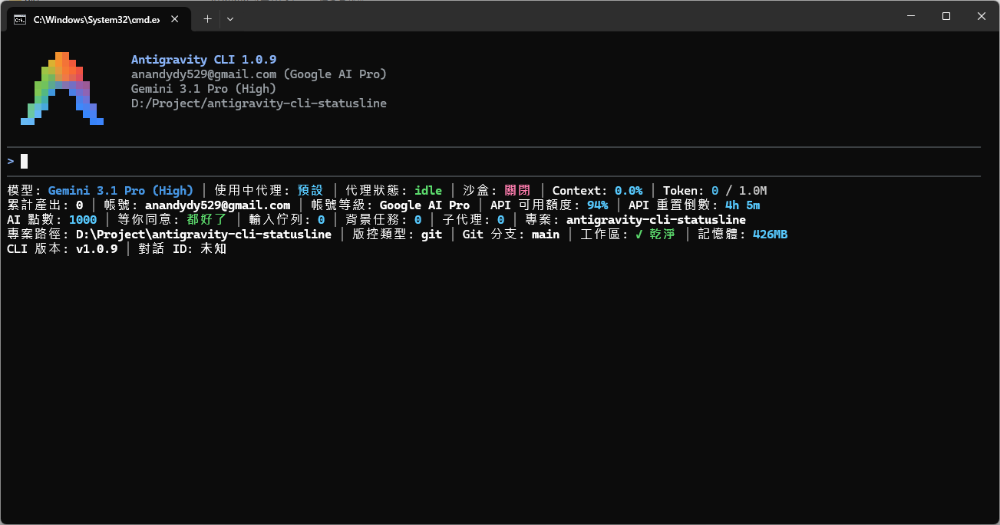
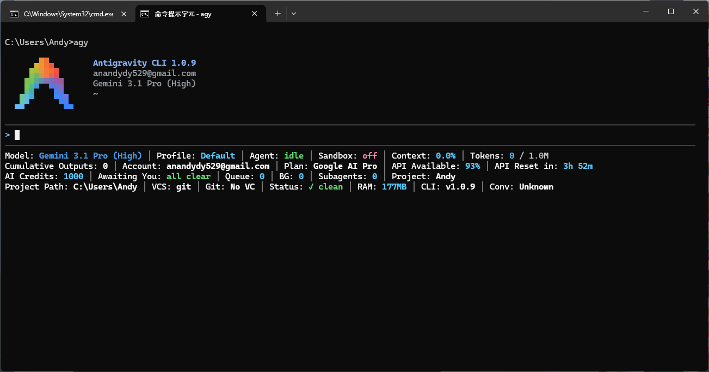
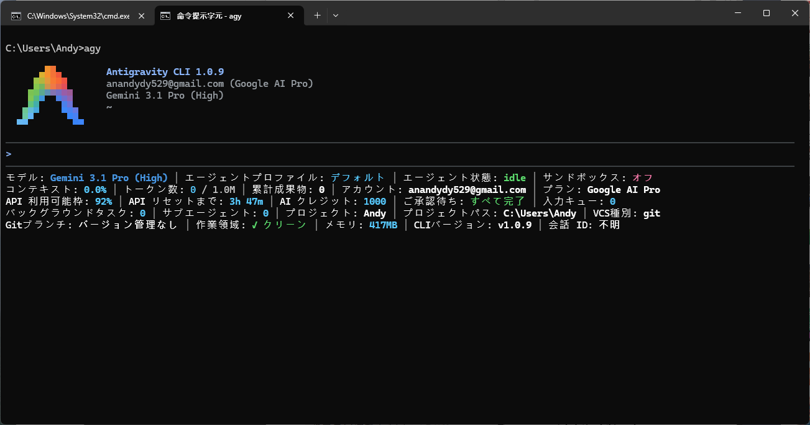
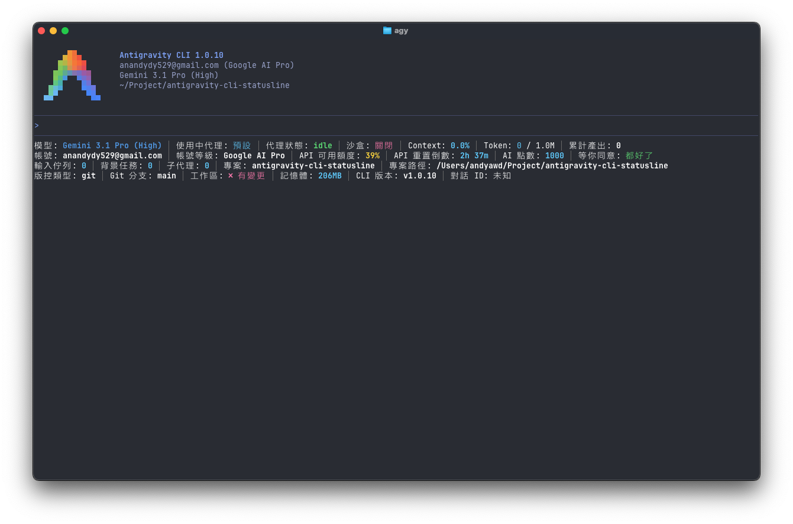
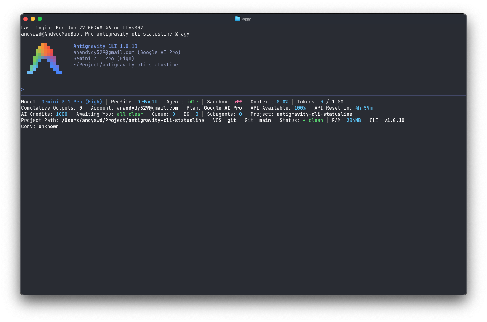
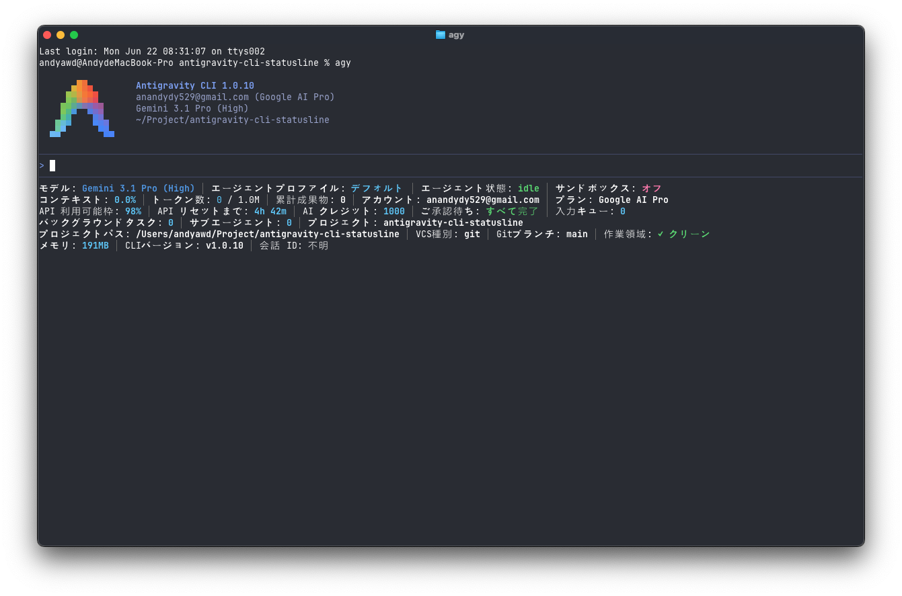

# Antigravity CLI 状态栏设置技能

[](skills/agy-cli-statusline/SKILL.md)
[](LICENSE)
[]()

[繁體中文](README.zh-TW.md) | 简体中文 | [English](README.md)

一个多语言、跨平台的技能，用于自定义 Antigravity CLI 状态栏（Footer）——精准勾选想要显示的指标、自由排序，并内置智能换行。

## 实际效果截图

### Windows

| 繁体中文 (zh-tw) | 简体中文 (zh-cn) | English (us) | 日本语 (jp) |
| :---: | :---: | :---: | :---: |
|  | *(支持 zh-cn 模式)* |  |  |

### macOS

| 繁体中文 (zh-tw) | 简体中文 (zh-cn) | English (us) | 日本语 (jp) |
| :---: | :---: | :---: | :---: |
|  | *(支持 zh-cn 模式)* |  |  |

## 安装

### 环境要求

- **Node.js**（必需）：渲染脚本以纯 `.mjs` 编写；若缺失，状态栏将空白并在反复失败后被 `agy` 自动禁用。技能会在写入配置前进行预检。
- **Git**（可选）：用于显示 `git-branch`、`vcs-dirty`、`vcs-type` 指标。

### 步骤 A：安装插件

```bash
agy plugin install https://github.com/andyawd/antigravity-cli-statusline
```

> CLI 会将 bundle stage 至 `~/.gemini/antigravity-cli/plugins/antigravity-cli-statusline/`。

### 步骤 B：触发 Skill 完成设置

在 Antigravity CLI 提示符输入：

```text
/antigravity-cli-statusline:agy-cli-statusline
```

技能会引导您选择语言、勾选指标、排序，并将渲染脚本部署到位、写入三层 `settings.json`。状态栏**热更新立即生效**，无需重启 CLI。

## 指标、排序与换行

### 可显示的指标

**AI 模型与代理**
- **当前使用的 AI 模型名称（`model-name`）**：实时显示对话正在使用的模型
- **使用中代理（`agent-profile`）**：当前加载的 Agent Profile 名称
- **代理当前状态（`agent-state`）**：`idle / thinking / working / tool_use / initializing`
- **当前 CLI 运行模式（`mode`）**：当前作用中的运行模式（`default / code-only / plan / interactive / accept-edits`）

**额度与 Token**
- **账号真实 API 可用额度（`quota`）**：百分比，搭配四阶配色
- **API 重置时间倒计时（`quota-reset-countdown`）**：距离下次额度重置剩余时间
- **账号每周 API 可用额度（`quota-weekly`）**：每周剩余百分比，搭配四阶配色
- **每周 API 重置时间倒计时（`quota-weekly-countdown`）**：距离每周额度重置剩余时间
- **当前对话已消耗的上下文（Context）比例（`context-used`）**：百分比
- **当前会话消耗的精确 Token 数量（`token-count`）**
- **本次对话 AI 累计产出的文件数量（`artifacts`）**
- **当前订阅计划等级（`plan-tier`）**

**交互状态**
- **等你响应的工具确认对话框（Dialog Box）（`tool-confirmation`）**
- **队列中待处理的用户输入数（`pending-input`）**
- **进行中的后台任务数（`background-tasks`）**
- **活跃子代理数（`subagents`）**

**项目与版本控制**
- **当前工作区项目短路径（`project-path`）**
- **当前工作区项目完整路径（`project-full-path`）**
- **版本控制类型（`vcs-type`）**：`git / jj / fig`
- **当前工作区的 Git 分支（`git-branch`）**
- **工作区是否有未提交变更（`vcs-dirty`）**：`dirty / clean`

**系统与账号**
- **CLI 进程所消耗的 RAM 内存量（`memory-usage`）**
- **Antigravity CLI 版本号（`cli-version`）**
- **当前对话 ID 前 8 位（`conversation-id`）**：用于调试
- **沙箱模式状态（`sandbox-status`）**：`off / on (net) / on (no-net)`
- **账号电子邮件（`account-email`）**

### 排序

在技能流程第三阶段（步骤 4），在 Write-in 输入框填入以逗号分隔的序号即可自定义排序：

```text
1,5,6,10,11,n,2,14,7,15,16,17,n,n,8,9,18,19,n,22,21,12,13,n,n,26,25,3,4,23,20,24
```

- 数字 = 步骤 3 勾选列表中的序号（从 1 起算）
- 也可混用英文标识码（如 `quota`、`model-name`），但用数字最直观
- 可混入 `n` 进行强制换行（连续 `n,n` 可产生空行分隔）
- **未提及的指标会被剔除**——排序结果即为最终显示集合
- 若留空或选择 `(Recommended) 跳过` 就会沿用勾选顺序、显示全部勾选的指标

排序后显示效果预览（五段分区并搭配空行分隔）：

```text
模型: Gemini 3.8 Flash (High) │ 上下文用量: 3.4% │ 令牌数: 35.7k / 1.0M │ 小时可用: 98% │ 小时倒计时: 4h 50m
代理角色: 默认 │ 工具待确认: 都好了 │ 产出文件数: 0 │ 待处理输入: 0 │ 后台任务: 0 │ 子代理: 2

账号: anandydy529@gmail.com │ 订阅计划: Google AI Pro │ 项目: antigravity-cli-statusline
完整路径: /Users/andyawd/Project/antigravity-cli-statusline
工作区状态: ✓ 干净 │ Git: main │ 每周可用: 78% │ 每周倒计时: 4d 5h

模式: Accept-edits │ 对话ID: c5168b1c │ 代理状态: working │ 沙箱状态: 关闭 │ 内存: 279MB │ VCS类型: git │ CLI版本: v1.3.2
```

### 换行

两种机制并存：

1. **自动智能折行**：渲染脚本会读取终端宽度，当下一个指标会超出时自动折到下一行，无需任何配置。
2. **强制换行**：在排序字符串中插入 `n` token 即可在指定位置强制换行，可重复使用：

```text
1,2,n,3,4
```

（若步骤 3 勾选了 4 个指标，此例会把 1、2 显示在第一行，并强制把 3、4 折到第二行。）

### 动态色彩

采用 24-bit truecolor 四阶柔和配色（蓝 → 绿 → 黄 → 粉红），依 API 额度或 Context 消耗比例变色；不同 AI 模型家族也会应用专属的品牌识别色。

## 贡献指南

非常欢迎大家贡献——包括新增指标、跨平台修复、以及通过 AI 一键新增其他语言翻译。详见 **[CONTRIBUTING.md](CONTRIBUTING.md)**。

## 致谢

特别感谢 [60ke/antigravity-statusline](https://github.com/60ke/antigravity-statusline) 项目。本项目的额度监控灵感正是来自于此。由于该原项目主要使用 Python 编写，在 Windows 和 macOS 跨平台执行上可能遇到环境配置的困难，因此本项目使用 JavaScript (Node.js) 进行改写，以实现真正的跨平台免额外依赖执行。

## 许可证

本项目采用 [MIT License](LICENSE) 授权。
