# antigravity-cli-statusline

[English](README.md) | 繁體中文 | [简体中文](README.zh-CN.md) | [日本語](README.ja.md)

[](skills/agy-cli-statusline/SKILL.md)
[](LICENSE)
[]()

一個同時支援 **Antigravity 命令列介面（`agy`）** 與 **Antigravity App（2.0，`v2.34.0+`）** 的外掛程式（Plugin）——支援從 40 項即時指標（模型、Orchestrator 實際執行模型、5 小時／7 日／Argon 額度、脈絡權杖分解、Git 狀態、代理狀態、CLI 與 2.0 版本號）中自由挑選、切換文字（`text`）或繪圖符號（`emoji`）標籤風格、在 Antigravity 2.0 側邊欄以滑鼠分列拖曳調序與換行（或於 CLI 使用 7 步驟問卷精靈），並提供 4 種顯示語系（`zh-tw`、`zh-cn`、`us`、`jp`）。

全面支援 Google Antigravity 的三大核心平台：Antigravity 命令列介面（`agy`）、Antigravity 整合開發環境（Integrated Development Environment）以及 Antigravity 2.0 桌面應用程式。

## 狀態列實際運作展示

<p align="center">
  
</p>

動態展示從執行設定指令 `/antigravity-cli-statusline:agy-cli-statusline`、問卷互動選取指標、自訂排序輸入，到最終呈現 11 列高資訊密度狀態列的完整即時遙測流程。

## 如何安裝

透過 Antigravity 命令列介面進行全域安裝：

```bash
agy plugin install https://github.com/AndyAWD/antigravity-cli-statusline
```

### 環境需求

- **Node.js**（必要）：渲染腳本以純 `.mjs` 撰寫；若系統未安裝 Node.js，狀態列將呈現空白，且 `agy` 會在連續失敗 30 次後自動停用狀態列。本技能在寫入設定前會先執行環境預檢。
- **Git**（選用）：用於讀取 `git-branch`、`vcs-dirty`、`vcs-type` 等版本控制系統（Version Control System）指標。

### 啟用與生效機制

- **初次啟用（CLI）**：初次安裝或初次啟用狀態列時，可直接於 `agy` 輸入配置腳本輸出的 `/statusline <command>` 立即啟用；若採用重新載入方式，請重新啟動 `agy` 命令列介面（退出後重新開啟）以載入狀態列掛鉤（Hook）。
- **熱更新（Hot Reload，CLI）**：先前已啟用狀態列者，後續調整指標順序、切換標籤顯示風格（`text` / `emoji`）或切換語系時，狀態列會直接熱更新生效，無需重新啟動命令列介面。
- **Antigravity App（2.0，`v2.34.0+`）**：透過模型上下文協定（Model Context Protocol）應用程式（MCP Apps，`ui://statusline/app.html`）開箱即用，**無需執行 `npm install`**。可於 **Overview > Plugins > Statusline**、側邊欄 **`+`** 選單（輔助面板）或左側導覽列 **Plugins > Statusline**（全頁）開啟；首次執行會自動繼承 CLI `settings.json` 排版，並支援「僅套用至 2.0 面板」或「同步套用至 2.0 ＋ CLI」及選配掛鉤部署。

## 特色亮點

1. **跨平台相容**：支援 Antigravity 命令列介面終端機、整合開發環境側邊欄對話方塊（Dialog Box）以及 Antigravity 2.0 桌面應用程式，涵蓋 Windows、macOS 與 Linux 作業系統。
2. **40 項即時指標、4 種語系與雙標籤顯示風格**：涵蓋人工智慧（Artificial Intelligence）模型狀態（含 Orchestrator 模式下即時追蹤 `[思考]` 規劃模型與 `[快速]` 執行模型之實際底層模型）、應用程式介面（Application Programming Interface）配額（含五小時、每週與 Gemini 4 Argon 專屬配額，並具備四層動態配額池歸屬解析與 60 秒過期寬限期即時倒數重算）、脈絡（Context）與權杖（Token）消耗、互動佇列、Git 版本控制狀態及系統資源，支援繁體中文（`zh-tw`）、簡體中文（`zh-cn`）、英文（`us`）與日文（`jp`），並可自由切換**文字標籤（`text`）**或**繪圖符號標籤（`emoji`，無冒號精簡排版）**顯示風格（`ui.footer.labelStyle`）。
3. **彈性百分比長條圖（支援合併與分開顯示）**：針對五小時額度、每週額度、Gemini 4 Argon 額度、脈絡用量與權杖數提供預設 10 格視覺長條圖（`[████████░░]`）；當數值與長條圖相鄰時自動合併為單一標籤，未相鄰時則各自以獨立標籤顯示。
4. **自訂排序與雙軌換行機制**：支援以數字序號或英文識別碼（Identifier）排序、使用 `n` 強制換行、使用 `n,n` 建立空白分隔行，並依終端機寬度自動智慧折行。
5. **24-bit 四階動態色彩**：依據配額剩餘比例或脈絡消耗程度自動切換 4 個色階（`#57caff` 藍色 `100~75%`、`#5cdb6d` 綠色 `74~50%`、`#ffd427` 黃色 `49~25%`、`#ff7daf` 粉紅色 `24~0%`），並為不同人工智慧模型家族套用專屬品牌識別色。
6. **三層設定檔同步與系統防護**：自動同步命令列介面專屬、全域與專案三層 `settings.json` 及 `trusted_hooks.json`，內建 macOS/Linux NVM 絕對路徑解析與 Windows UTF-8 位元組順序記號（Byte Order Mark）自動剝除機制。
7. **初次開啟更新檢查與手動掛鉤同步**：當 `ui.footer.items` 啟用 `plugin-update`（`#39`）時，每次啟動互動式 `agy` 命令列介面會自動檢查一次 GitHub Releases（略過 `agy -p`），無更新自動隱藏並修剪頭尾純空白行，離線時沿用快取版本比對，落後時於設定位置獨立顯示兩行在地化更新指令提醒（繪圖符號模式精簡顯示 `🆕 vX → vY`），且與僅顯示狀態列版本號的 `plugin-version`（`#38`）完全解耦、不影響單行排版。掛鉤程式碼維持由 `/antigravity-cli-statusline:agy-cli-statusline` 手動同步，並可透過 `diagnose-statusline.mjs` 檢查外掛與掛鉤版本差異。
8. **Antigravity 2.0 原生視覺化面板（MCP Apps）**：提供側邊輔助面板與全頁儀表板，支援就地分列拖曳排版、`5 大分類 40 項指標` 抽屜與即時數值預覽、可收合權杖分類明細（`tokenBreakdown`）堆疊條、1 秒即時倒數、舊版排序語法匯入／匯出，以及雙按鈕獨立或同步儲存。

## 如何管理與切換外掛程式

• 列出已安裝外掛：

  ```bash
  agy plugin list
  ```

• 啟用外掛：

  ```bash
  agy plugin enable antigravity-cli-statusline
  ```

• 停用外掛：

  ```bash
  agy plugin disable antigravity-cli-statusline
  ```

• 移除外掛：

  ```bash
  agy plugin uninstall antigravity-cli-statusline
  ```

## 專案資料夾目錄

```text
antigravity-cli-statusline/
├── plugin.json                                     # Antigravity 外掛清單
├── mcp_config.json                                 # Antigravity 2.0 MCP 伺服器設定
├── hooks.json                                      # 生命週期掛鉤（SessionStart/PreInvocation/PostInvocation/Stop）
├── package.json                                    # 套件中繼資料與 npm 腳本
├── LICENSE                                         # MIT 授權條款
├── CONTRIBUTING.md                                 # 三語系貢獻指南
├── README.md / README.zh-TW.md / README.zh-CN.md / README.ja.md
├── assets/
│   └── logo.svg                                    # Antigravity App 外掛圖示
├── docs/
│   ├── ARCHITECTURE_HANDOVER.md                    # 四層架構交接與擴充手冊
│   ├── images/                                     # 實機截圖與動態範例向量圖
│   └── workshop/                                   # 工作坊簡報與素材
├── src/app/                                        # Antigravity 2.0 MCP App 前端原始碼（esbuild）
├── scripts/
│   ├── build-app.mjs                               # 編譯 src/app/ 為單一檔案 scripts/mcp/statusline-app.html
│   ├── hooks/record-session.mjs                    # 生命週期掛鉤寫入腳本（隔離於 ${PLUGIN_DATA}）
│   ├── mcp/                                        # MCP 伺服器、LS 遙測、對話紀錄讀取與 CLI 橋接
│   └── tests/                                      # Antigravity 2.0 Hook、MCP 與同步契約測試
└── skills/
    ├── agy-app-statusline/
    │   └── SKILL.md                                # Antigravity 2.0 視覺化面板技能入口
    └── agy-cli-statusline/
        ├── SKILL.md                                # CLI 七步驟問卷精靈入口
        ├── references/                             # 技術規格、設定檔、Windows 與陷阱文件
        ├── resources/                              # 自動生成的四語系對話範本與五大分類問卷
        └── scripts/                                # CLI statusLine 掛鉤與四層零相依 ESM 模組
```

## 指令功能說明

安裝完成後，可依目前使用的介面執行對應斜線指令（Slash Command）：

### 1. 開啟視覺化狀態列面板（Antigravity 2.0 App）

```text
/antigravity-cli-statusline:agy-app-statusline
```

- **使用情境**：在 Antigravity App（`v2.34.0+`）直接於右側輔助面板開啟 **Statusline** 即時監控與分列拖曳排版介面（不需回答任何 `ask_question` 問卷）；亦可隨時從右上角 **Overview > Plugins > Statusline** 或左側導覽列 **Plugins > Statusline** 開啟。

### 2. 狀態列設定技能（Antigravity CLI）

```text
/antigravity-cli-statusline:agy-cli-statusline
```

- **使用情境**：初次啟用命令列介面狀態列、切換顯示語系（`zh-tw` / `zh-cn` / `us` / `jp`）、切換文字（`text`）或繪圖符號（`emoji`）標籤顯示風格、增減顯示指標，或重新調整多行排版順序時。
- **運作流程**：
  1. 詢問顯示語系，並將後續所有設定互動鎖定為所選語系。
  2. 執行 Node.js 環境預檢（三層 `settings.json` 讀寫一律由步驟 5 的 `configure-statusline.mjs` 安全處理，不直接存取 `~/.gemini/`）。
  3. 載入 `questions.json` 以五大分類分頁依序提供指標勾選，避開終端機螢幕高度截斷問題。
  4. 列出使用者所選指標，接收自訂排序與個別樣式前綴（支援純數字、`t` 文字前綴、`e` 繪圖符號前綴與 `n` 換行符號），將 `ui.footer.items` 與 `ui.footer.itemStyles` 寫入三層 `settings.json`，並將主掛鉤腳本、四層 `lib/` 子模組及 `.hook-version.json` SHA-256 雜湊清單同步部署至 `~/.gemini/antigravity-cli/hooks/` 完成測試驗證。
  5. 設定完成後，自動以程式碼區塊回報先前與本次的排版順序字串，方便隨時複製貼上重現設定。

---

## 指標、排序與換行

### 可顯示的指標（1–40）

以下編號對應技能步驟 3 問卷（`resources/questions.json`）中五大分類分頁選項序號（從 1 起算），以及各指標在 `emoji` 模式下對應的繪圖符號：

**1. 模型與代理（5 項）**
- `1.` 🤖 **目前使用的人工智慧模型名稱（`model-name`）**：即時顯示對話正在使用的模型
- `2.` 🪪 **使用中代理（`agent-profile`）**：目前載入的 Agent Profile 名稱
- `3.` ⚡ **代理當前狀態（`agent-state`）**：`閒置 / 思考中 / 執行中 / 呼叫工具 / 初始化`
- `4.` ⚙️ **目前運行模式（`mode`）**：`default / code-only / plan / interactive / accept-edits`
- `5.` 🧭 **編排器當前實際執行的底層模型（`active-model`）**：使用 Orchestrator 時即時顯示實際執行的底層模型與 `[思考]`／`[快速]` 角色徽章；非 Orchestrator 模式自動隱藏

**2. 額度、計費與帳號（14 項）**
- `6.` 🔋 **帳號五小時可用額度百分比（`quota`）**：五小時應用程式介面可用額度百分比，搭配四階配色
- `7.` 🔋 **五小時可用額度長條圖（`quota-bar`）**：10 格五小時可用額度長條圖（`[████████░░]`）
- `8.` ⏳ **帳號五小時額度重置時間倒數（`quota-reset-countdown`）**：距離五小時額度重置的剩餘時間
- `9.` 🕒 **五小時重置時間（`quota-reset-time`）**：本機時區絕對重置時間（預設同日 `HH:mm`、跨日 `yyyy/MM/dd HH:mm`）
- `10.` 📅 **帳號每週可用額度百分比（`quota-weekly`）**：每週應用程式介面可用額度百分比，搭配四階配色
- `11.` 📅 **每週可用額度長條圖（`quota-weekly-bar`）**：10 格每週可用額度長條圖（`[███████░░░]`）
- `12.` ⏲️ **帳號每週額度重置時間倒數（`quota-weekly-countdown`）**：距離每週額度重置的剩餘時間
- `13.` 🗓️ **每週重置時間（`quota-weekly-reset-time`）**：每週額度重置的本機絕對時間（如 `2026/10/18 16:00`）
- `14.` ✨ **Gemini 4 Argon 可用額度百分比（`quota-argon`）**：Gemini 4 Argon 專屬配額百分比，搭配四階配色
- `15.` ✨ **Gemini 4 Argon 可用額度長條圖（`quota-argon-bar`）**：10 格 Argon 可用額度長條圖（`[█████░░░░░]`）
- `16.` ⏱️ **Gemini 4 Argon 額度重置時間倒數（`quota-argon-countdown`）**：距離 Argon 額度重置的剩餘時間
- `17.` ⏰ **Gemini 4 Argon 重置時間（`quota-argon-reset-time`）**：Argon 額度重置的本機絕對時間（如 `2026/10/30 23:57`）
- `18.` 💎 **目前訂閱方案等級（`plan-tier`）**：目前帳號的訂閱等級
- `19.` 📧 **帳號電子郵件（`account-email`）**：目前登入的帳號信箱

**3. 脈絡與權杖（4 項）**
- `20.` 🧠 **目前對話已消耗的脈絡用量比例（`context-used`）**：脈絡視窗已消耗百分比
- `21.` 🧠 **脈絡用量長條圖（`context-used-bar`）**：10 格脈絡消耗長條圖（`[█░░░░░░░░░]`）
- `22.` 💰 **目前工作階段（Session）消耗的精確權杖數量（`token-count`）**：目前對話累計權杖數
- `23.` 💰 **權杖數長條圖（`token-count-bar`）**：10 格權杖消耗長條圖（`[█░░░░░░░░░]`）

**4. 工作區與版本控制（5 項）**
- `24.` 📁 **目前工作區專案短路徑（`project-path`）**：工作區資料夾名稱
- `25.` 📍 **目前工作區專案完整路徑（`project-full-path`）**：工作區絕對路徑
- `26.` 🔀 **目前工作區專案的 Git 分支（`git-branch`）**：目前所在的 Git 分支名稱
- `27.` 🔍 **工作區是否有未提交變更（`vcs-dirty`）**：`未提交 / 無變更`
- `28.` 🗃️ **版本控制類型（`vcs-type`）**：`git / jj / fig`

**5. 系統狀態與背景任務（12 項）**
- `29.` 💾 **命令列介面行程所消耗的隨機存取記憶體量（`memory-usage`）**：`agy` 行程佔用的記憶體大小
- `30.` 🚀 **Antigravity 命令列介面版本號（`cli-version`）**：已安裝的 `agy` 命令列介面版本（文字模式標籤為 `Agy CLI 版本:`；於 CLI 與 2.0 皆會自動偵測顯示）
- `31.` 💬 **目前對話識別碼前 8 碼（`conversation-id`）**：供除錯定位使用
- `32.` 🛡️ **沙盒模式狀態（`sandbox-status`）**：`off / on (net) / on (no-net)`
- `33.` 🔔 **是否有等你回應的工具確認對話方塊（`tool-confirmation`）**：提示是否有工具正在等待使用者確認
- `34.` 📥 **佇列中待處理的使用者輸入數（`pending-input`）**：排隊等待執行的輸入數量
- `35.` 🔄 **進行中的背景任務數（`background-tasks`）**：執行中的背景行程數量
- `36.` 👥 **活躍子代理數（`subagents`）**：運行中的子代理數量
- `37.` 📄 **本次對話人工智慧累計產出的檔案數量（`artifacts`）**：本次對話產出的 Artifacts 數量
- `38.` 🧩 **狀態列版本號（`plugin-version`）**：僅顯示已安裝的 `antigravity-cli-statusline` 版本號（文字模式標籤為 `狀態列版本:`；不觸發更新檢查或提醒）
- `39.` 🆕 **狀態列新版本更新提醒（`plugin-update`）**：於每次開啟互動式 `agy` 時檢查一次 GitHub Releases（略過 `agy -p`），無更新自動隱藏，有新版時於排定位置顯示兩行更新提醒
- `40.` 💻 **Antigravity 2.0 應用程式版本號（`app-version`）**：已安裝的 Antigravity 2.0 桌面應用程式版本號（文字模式標籤為 `Agy 2.0 版本:`；於 CLI 與 2.0 皆會自動偵測顯示）

### 排序規則與樣式設定

在技能步驟 4 的自訂排序輸入框（Write-in）填入以逗號分隔的指標序號，即可完成排序與個別樣式設定（未列入的指標不予顯示；留白或選擇略過則沿用原勾選順序與預設文字樣式）：

- **樣式前綴設定**：
  - **文字標籤樣式（`text`，預設）**：純數字序號（如 `1`）、`t` 前綴（如 `t1`）或純英文識別碼（如 `quota`、`t:quota`），顯示為所選語系的文字標籤搭配冒號（例如 `五小時可用: 88%`）。
  - **繪圖符號樣式（`emoji`）**：使用 `e` 前綴（如 `e1`、`e:quota`，大小寫不分），將文字標籤替換為繪圖符號加單一空白（例如 `🔋 88%`），狀態值仍維持多語系顯示。
  - **個別混搭**：各指標可獨立指定樣式（例如 `e1, 19, e18, 32`），未指定者預設為文字樣式。
- **百分比長條圖合併與分開機制**：
  - 針對五組指標配對（`quota` `6`+`7`、`quota-weekly` `10`+`11`、`quota-argon` `14`+`15`、`context-used` `20`+`21`、`token-count` `22`+`23`），當數值指標與長條圖**相鄰排列**（如 `6,7`）且樣式一致時，自動合併為單一標籤與進度條。
  - 若兩者**未相鄰**（中間隔有其他指標或換行）或樣式衝突（一為 `text`、一為 `emoji`）時，則各自以獨立標籤分開顯示。
  - 長條圖預設長度為 10 格（`[████████░░]`，可透過 `ui.footer.barLength` 自訂），絕對重置時間格式可透過 `ui.footer.timeFormat` 設定。
- **換行與分區間隔**：
  - **強制換行（`n`）**：插入 `n` 在指定位置換行；連續插入 `n,n` 可產生一行空白分隔行。
  - **自動智慧折行**：當指標總長度超出終端機視窗寬度時，渲染器會自動折疊至下一行。
- **動態色彩變換**：
  - 狀態列採用 24-bit truecolor 四階柔和配色（`#57caff` 藍色 → `#5cdb6d` 綠色 → `#ffd427` 黃色 → `#ff7daf` 粉紅色），依據額度剩餘比例或脈絡消耗比例動態變色；不同模型家族亦套用專屬品牌識別色。

#### 排序輸入範例

- **數字序號版本**：
  ```text
  e1,e19,e18,e32,n,e2,3,36,37,34,35,33,n,n,20,21,22,23,n,6,7,8,9,n,10,11,12,13,n,14,15,16,17,n,n,27,28,e26,n,e24,25,n,e4,e31,e29,30,38,39
  ```

- **英文識別碼版本**：
  ```text
  e:model-name,e:account-email,e:plan-tier,e:sandbox-status,n,e:agent-profile,agent-state,subagents,artifacts,pending-input,background-tasks,tool-confirmation,n,n,context-used,context-used-bar,token-count,token-count-bar,n,quota,quota-bar,quota-reset-countdown,quota-reset-time,n,quota-weekly,quota-weekly-bar,quota-weekly-countdown,quota-weekly-reset-time,n,quota-argon,quota-argon-bar,quota-argon-countdown,quota-argon-reset-time,n,n,vcs-dirty,vcs-type,e:git-branch,n,e:project-path,project-full-path,n,e:mode,e:conversation-id,e:memory-usage,cli-version,plugin-version,plugin-update
  ```

*(註：亦支援 `model-name`、`e:quota` 等英文識別碼，使用數字序號可縮短輸入字數。)*

#### 效果預覽（混搭模式）

包含四大邏輯分區、共 9 行資訊並搭配空白分隔行：

```text
🤖 Gemini 3.8 Flash (High) │ 📧 anandydy529@gmail.com │ 💎 Google AI Pro │ 🛡️ 關閉
🪪 Default │ 代理狀態: 執行中 │ 子代理: 2 │ 產出檔案: 0 │ 待處理輸入: 0 │ 背景任務: 0 │ 工具待確認: 無

脈絡用量: 18.5% [█░░░░░░░░░] │ 權杖數: 47.4k / 256.0k [█░░░░░░░░░]
五小時可用: 88% [████████░░] │ 五小時倒數: 4h 50m │ 五小時重置: 15:50
七日內可用: 78% [███████░░░] │ 七日內倒數: 4d 5h │ 七日內重置: 2026/10/18 16:00
Argon 可用: 59% [█████░░░░░] │ Argon 倒數: 6d 1h │ Argon 重置: 2026/10/30 23:57

版控狀態: 無變更 │ 版控類型: git │ 🔀 main
📁 antigravity-cli-statusline │ 完整路徑: /Users/andyawd/Project/antigravity-cli-statusline
⚙️ Accept-edits │ 💬 c5168b1c │ 💾 279MB │ Agy CLI 版本: v1.5.10 │ 狀態列版本: v1.13.0
```

當啟用 `plugin-update`（`#39`）且偵測到較新的 GitHub Release 時，會於設定的位置獨立顯示兩行更新提醒（在終端機執行 `agy plugin install` 後版本即追平並自動消除提醒；如需同步 `~/.gemini/antigravity-cli/hooks/` 掛鉤腳本請重跑 `/antigravity-cli-statusline:agy-cli-statusline`，或執行 `node skills/agy-cli-statusline/scripts/diagnose-statusline.mjs` 檢查版號差異）：

```text
⚠️ 狀態列有新版本可用（目前 v1.12.0 → 最新 v1.13.0），請執行以下指令更新：
agy plugin install https://github.com/AndyAWD/antigravity-cli-statusline
```

採用繪圖符號樣式（`e39` / `e:plugin-update`）時，第一行會精簡顯示為 `🆕 v1.12.0 → v1.13.0` 並搭配第二行獨立更新指令；若版本已是最新則自動隱藏並修剪頭尾純空白行。

## 貢獻指南

歡迎提交貢獻——包含新增指標、跨平台修正以及新增其他語系翻譯。詳細專案結構與工作流程請參閱 [CONTRIBUTING.md](CONTRIBUTING.md)。

## 鳴謝

特別感謝 [60ke/antigravity-statusline](https://github.com/60ke/antigravity-statusline) 專案。本專案的額度監控靈感正是來自於此。由於該原專案主要是使用 Python 撰寫，在 Windows 和 macOS 跨平台執行上可能遇到環境設定的困難，因此本專案使用 JavaScript (Node.js) 進行改寫，以實現真正的跨平台免額外依賴執行。

## 授權條款

本專案採用 MIT 授權條款釋出，詳情請參閱 [LICENSE](LICENSE) 檔案。
